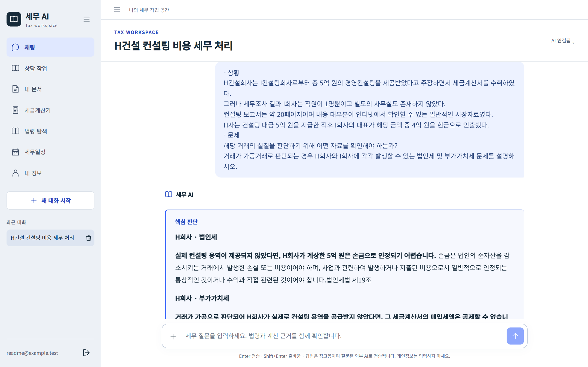
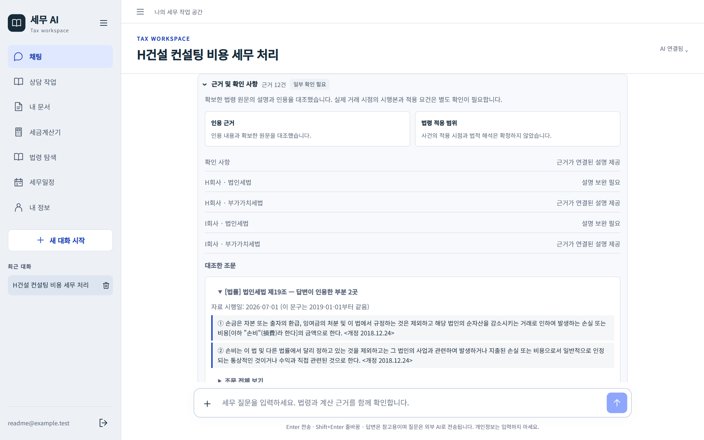
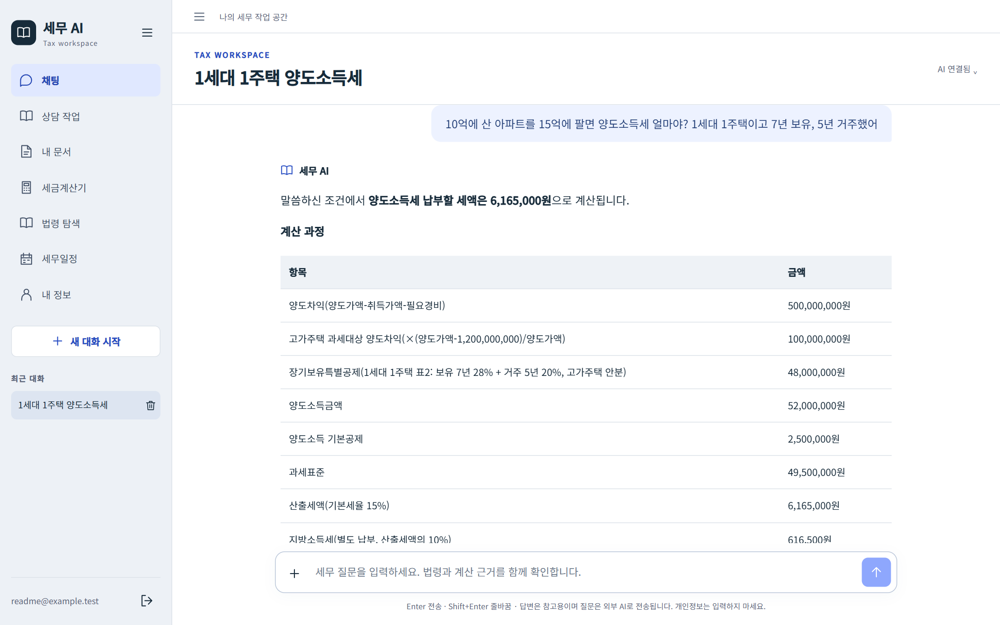
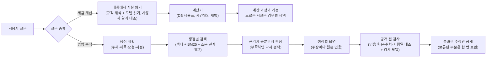

# 세무 AI 어시스턴트

**한국 세법 질문에 법령 원문을 근거로 답하고, 세금은 검증된 계산기로 계산하는 AI 세무 상담 서비스**<br>
*Korean tax AI assistant with statute-grounded answers, per-claim citation checks and verified tax calculators*

[](https://github.com/pth6254/tax_assistant/actions/workflows/ci.yml)


일반 챗봇에 세무 질문을 하면 그럴듯하지만 근거 없는 답(없는 조문, 틀린 세율, 계산 실수)이 나오기 쉽습니다.
이 프로젝트는 그 문제를 **답변 구조로 막는 것**에 집중했습니다.

- **문장마다 근거**: 답변의 주장마다 법령 원문 인용을 붙이고, 그 인용이 실제 원문에 있는지 코드와 검사 모델이 확인한 주장만 보여 줍니다.
- **세액은 계산기가**: 세금은 언어 모델이 아니라 국세청 공식 계산 사례로 검증한 계산기가 계산합니다. 모델은 대화에서 사실을 읽기만 하고, 읽은 사실도 사용자가 실제로 한 말과 다시 대조합니다.
- **그날의 법으로**: 국가법령정보 공식 원문을 과거 시행본까지 보관해, 사건 날짜에 시행되던 조문과 세율로 판단합니다.

> 개인 프로젝트입니다. 답변은 참고용이며 세무 전문가의 자문을 대체하지 않습니다. 세무 전문가의 검수는 아직 받지 않았습니다.



| 근거 패널: 답변이 인용한 원문과 시행일 | 계산 질문: 계산 과정과 가정 |
|---|---|
|  |  |

<sub>화면 속 답변은 서비스가 실제로 만든 답변을 지금의 화면에 띄워 찍은 것입니다(재현 스크립트: `docs/portfolio/capture-readme.cjs`).</sub>

## 무엇을 할 수 있나

| 기능 | 설명 |
|---|---|
| 근거 기반 세무 상담 | 복합 질문을 주체·세목·요청·시점별 쟁점으로 나누고, 쟁점마다 법률·시행령·시행규칙·법령해석례를 찾아 검사를 통과한 주장만 모아 답합니다. 근거 패널에서 인용한 원문 구간과 시행일을 확인할 수 있습니다. |
| 세금 계산 7종 | 종합소득세(금융소득·가상자산 포함), 양도소득세, 상속세, 증여세, 부가가치세, 퇴직소득세, 가산세. 2021년부터의 세율표로 과세 사건 날짜의 세법을 적용하고, 계산 과정과 가정을 함께 보여 줍니다. |
| 대화로 계산하기 | "2014년에 사서 2019년까지 살았어", "서초구 반포동이야", "네 맞아요"처럼 말해도 사실을 읽습니다. 세액을 가르는 사실을 모르면 경우별 세액을 보여 주고 어느 경우인지 묻습니다. |
| 과거 법령 | 사건일에 시행되던 법령 시행본을 찾아 근거로 씁니다. |
| 내 문서 검색 | PDF·DOCX·HWPX·PPTX·HTML을 올리면 사용자별로 분리해 검색합니다. |
| 업무 화면 | 세목별 상담 작업 공간, 계산기 화면, 세무 일정, 조문 원문 뷰어, 답변 다시 생성·버전 비교 |

자세한 동작과 지원 범위는 [기능 상세](docs/FEATURES.md)에 있습니다.

## 어떻게 동작하나



설계에서 지킨 원칙은 네 가지입니다.

1. **의미 파악은 모델, 확정은 코드.** 모델이 고른 근거·사실은 원문이나 사용자 말과 글자 그대로 대조해 맞는 것만 씁니다. 기간 계산, 세액, 시행일 판단은 코드가 합니다.
2. **사실로 확정되는 검사만 단독으로 막는다.** 인용이 원문에 없거나 원문에 없는 세율·금액을 쓰면 보류하고, 단어로 의미를 짐작하는 검사는 검사 모델이 확인할 신호로만 넘깁니다. 환각은 막고 맞는 답은 막지 않기 위해서입니다.
3. **원본은 하나.** 공식 법령 XML 보관소가 원본이고, 검색용 현행 조문 표와 벡터는 그 파생물입니다. 감사 스크립트로 둘이 같은지 확인합니다.
4. **모르는 것은 가정하지 않는다.** 정해지지 않은 사실은 경우별로 계산하거나 "추가 확인 필요"로 나눠 보여 주고, 확인된 부분까지는 답합니다.

구성 요소와 데이터 흐름은 [구조와 핵심 구현](docs/ARCHITECTURE.md)에 있습니다.

## 완성도와 검증 현황

기준일 **2026-11-07**. 각 수치의 측정 범위와 원본은 [현재 상태](docs/ai/CURRENT_STATUS.md)에 있습니다.

| 영역 | 상태 | 확인한 것 | 아직 하지 않은 것 |
|---|---|---|---|
| 근거 기반 분석 답변 | 동작 중 | 실제 질문으로 답변·근거 패널·저장까지 종단 점검, 공개 검사 규칙 단위 테스트 | **세무 정답률은 아직 측정하지 않았습니다.** 법제처 공식 회답 89건으로 정답셋을 만들었고, 실행은 비용 때문에 대기 중입니다. |
| 세금 계산기 7종 | 동작 중 | 세목마다 국세청 신고서 작성 사례·「세금절약가이드」 등 공식 계산 사례로 산식 검증 | 감면·특례 상당수, 국외 자산, 법인세 계산은 지원하지 않습니다. |
| 채팅 계산(대화 이해) | 동작 중 | 자연스러운 표현 평가셋 40건: 기대한 답이 나온 사례 11 → 40건, 계산 입력을 맞게 읽음 14/88 → 88/88 | 평가셋이 작고 전문가 검수 전입니다. 40건 중 33건은 마지막 수정 전 코드로 쟀습니다. |
| 법령 검색 | 동작 중 | 조문 검색 평가셋 203문항에서 정답 조문이 상위 5개 안에 든 비율 82.3%(서비스 검색 경로, 2026-11-06) | 일상 표현 질문의 1위 적중률은 26.6%로 낮습니다. |
| 법령 데이터 | 최신화 | 세법 13개 법률과 시행령·시행규칙의 현행 조문 6,670개를 공식 원본 보관소(시행본 5,400개)와 전수 대조해 차이 0, 법령해석례 207건 | 조문 간 인용 4,748건은 관계로 연결하지 못했습니다. |
| 자동 테스트 | 동작 중 | 백엔드 1,603개·프런트엔드 48개(모델·DB 없이 실행), 푸시마다 GitHub Actions에서 비밀값·문법·DB 마이그레이션·테스트 검사 | 실제 모델을 쓰는 평가는 비용 때문에 필요할 때만 수동 실행합니다. |
| 응답 시간 | 측정함 | 계산 질문 약 5초, 쟁점 5개 분석 질문 78초(같은 질문 103초에서 단축) | 더 줄이려면 검사 단계를 바꿔야 해서 정답셋으로 품질을 비교한 뒤 결정합니다. |
| 배포 | 일부 | 개인 PC의 Docker에서 운영하고 임시 주소로 지인과 공유(초대 코드·하루 질문 한도) | 상시 접속 가능한 배포는 아직 없습니다. |

### 알려진 한계

- 법적 판단이 맞는 비율(세무 정답률)은 아직 숫자로 말할 수 없습니다. 위 수치는 검색·사실 읽기·계산 산식을 잰 것입니다.
- 국외 세무, 법인세 세액 계산, 감면·특례 상당수는 범위 밖입니다. 범위 밖 계산은 공식 근거로 만든 참고 산식으로만 답하고, 확정 세액으로 내지 않습니다.
- 답변 생성과 검사는 외부 모델(OpenRouter)을 씁니다. 질문과 검색된 법령 발췌가 외부로 전송되므로 개인정보는 입력하지 않아야 합니다.

## 기술 스택

| 구분 | 기술 |
|---|---|
| 백엔드 | Python 3.12, FastAPI, asyncpg, Pydantic, LangChain(구조화 호출), SSE 스트리밍 |
| 프런트엔드 | React 18, Vite |
| 데이터 | PostgreSQL 17 + pgvector(조문·항 벡터), Neo4j(조문 인용 관계), Alembic |
| 검색 | 벡터 + Kiwi 형태소 BM25 결합(RRF), 조문 직접 조회, MMR, 위임 조문 결합, 그래프 확장 |
| 모델 | 생성·계획·검사: OpenRouter GPT 계열(작업별 설정 9개), 임베딩: Ollama `qwen3-embedding:4b`(로컬) |
| 데이터 수집 | 국가법령정보 Open API(법령·법령해석례·과거 시행본 XML) |
| 운영·평가 | Docker Compose, GitHub Actions, LangSmith(선택), 자체 평가 도구(`evaluation/`) |

## 빠르게 실행하기

필요한 것: Docker(WSL2), Ollama와 `qwen3-embedding:4b`, OpenRouter API 키, 국가법령정보 Open API 키.

```bash
cp .env.example .env                                  # 키와 비밀값을 채웁니다(값은 커밋하지 않습니다)
ollama pull qwen3-embedding:4b
bash dev/docker-up-wsl.sh backend frontend            # DB 마이그레이션 포함, http://localhost:3001
python scripts/ingest_laws.py --embed                 # 처음 한 번: 법령 수집과 임베딩
```

단계별 설치, 환경 변수, 테스트 실행, 자주 생기는 문제는 [설치·실행·테스트](docs/SETUP.md), HTTP API는 [API](docs/API.md)에 있습니다.

## 문서 안내

| 문서 | 내용 |
|---|---|
| [기능 상세](docs/FEATURES.md) | 기능별 동작, 계산기 지원 범위와 검증 사례, 사용 예시, 한계 |
| [구조와 핵심 구현](docs/ARCHITECTURE.md) | 시스템 구성, 데이터 흐름, 코드 구조, 핵심 구현 포인트, 보안 설계 |
| [설치·실행·테스트](docs/SETUP.md) | 설치, 환경 변수, 테스트, 문제 해결 |
| [API](docs/API.md) | HTTP API 목록 |
| [현재 상태](docs/ai/CURRENT_STATUS.md) | 구현 범위와 검증 수치의 원본(날짜·범위 포함) |
| [설계 결정](docs/ai/DECISIONS.md) | 결정, 이유, 바꾸는 조건 |
| [로드맵](docs/ai/ROADMAP.md) | 평가·성능 개선·배포 계획 |
| [평가 도구와 평가셋](evaluation/README.md) | 평가셋 구성, 판정 규약, 실행 방법 |
| [문서 전체 목록](docs/README.md) | 기능별 설계 문서와 날짜별 검증 기록 |

이 저장소는 AI 코딩 도구(Codex·Claude Code)와 함께 개발했습니다. 그 도구들이 따르는 작업 규칙은 [AGENTS.md](AGENTS.md)에 있습니다.

## 저장소 구조

```
app/
  routers/            HTTP API(인증·채팅·계산기·법령·문서·상담)
  services/
    chat_service.py         채팅 한 턴(도구 → 근거 답변 → 저장, SSE)
    reliable_workflow.py    쟁점 계획 → 검색 → 답변 → 검사 → 보완
    claim_verification.py   주장별 공개 검사(인용 원문·수치·시행일, 검사 모델)
    calculator/             세목별 계산기, 채팅 입력 해석, 대화 사실 읽기
    search/                 벡터·BM25·그래프 결합 검색
    law/                    법령 수집, 과거 시행본 보관소, 감사
frontend/             React 화면
alembic/              DB 스키마 버전
scripts/              법령 수집·감사·재색인 도구
evaluation/           평가셋과 평가 도구
tests/                자동 테스트
docs/                 문서
```

## 라이선스

라이선스는 아직 정하지 않았습니다.
