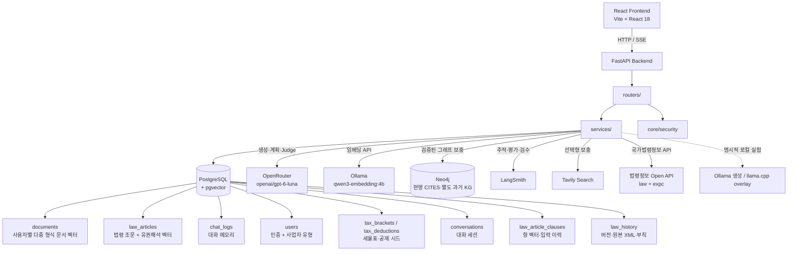

# 구조와 핵심 구현

시스템 구성, 데이터 흐름(법령 수집·채팅·계산기·문서 업로드), 기술 스택, 코드 구조, 핵심 구현 포인트와 보안 설계입니다. 설계 결정의 이유는 [DECISIONS](ai/DECISIONS.md)에 있습니다.

[← README로 돌아가기](../README.md)


## 시스템 아키텍처



### 계층 구조

```
HTTP 요청
  → routers/     입력 검증, 인증 확인, 응답 포맷
  → services/    비즈니스 로직, RAG 파이프라인
  → core/        JWT·인증 쿠키 등 전역 보안 구성
  → database.py  asyncpg 커넥션 풀 (싱글턴)
```

각 계층은 단방향으로만 호출됩니다.

## Agentic RAG 파이프라인

### 법령 수집 흐름

```
국가법령정보 API 키워드 검색 (세법, 조세, 국세 등 20개 키워드)
  → 소관부처 필터링 (기획재정부, 행정안전부, 관세청 등)
  → MST 기반 중복 제거
  → 법령 원문 XML 조회
  → 조문 단위 파싱 (조문번호, 제목, 본문)
  → SHA-256 해시로 중복/개정 감지
  → law_articles 테이블 저장 (embedding = NULL)
  → qwen3-embedding:4b 임베딩 생성 (배치 50개)
  → 벡터 저장 완료
```

### 법령 개정 자동 동기화 흐름 (`scripts/sync_laws.py`)

```
law_articles에 이미 수집된 법령 목록 조회 (법령해석례 제외)
  → 각 법령 재수집 (법령 수집 흐름과 동일한 API 재호출)
  → 조문번호(article_no) 단위로 이번 수집분의 content_hash 집합 계산
  → 기존 is_current=TRUE 행 중 이번 수집분 해시 집합에 없는 것만 개정으로 판단해 폐기
     (같은 조문번호 아래 여러 콘텐츠가 공존할 수 있어 조문 단위가 아닌 그룹 단위로 비교)
  → 신규/변경분만 임베딩 (--embed 옵션)
```
cron·Windows 작업 스케줄러에 등록해 주기 실행하는 것을 전제로 하며, 실패 시 non-zero exit code를 반환합니다.

### 법령해석례(유권해석) 수집 흐름 (`scripts/ingest_interpretations.py`)

```
국가법령정보 API 키워드 검색 (target=expc)
  → 법령해석례 일련번호(case_id) 목록 확보
  → 건별 본문 조회 (질의요지·회답·이유)
  → 안건명의 「법령명」에서 관련 법령 추출 → 세목 추론
  → law_articles 테이블 저장 (law_type='법령해석례')
  → qwen3-embedding:4b 임베딩 생성
```

### 세금 계산기 tool calling 흐름

```
질문 입력
  → 명시한 계산 요청인지 확인 (금액·세액 단어만으로 계산 의도 확정하지 않음)
  → 지원 범위: 도구/입력 선택 → Pydantic·필수 조건·사용자 입력 출처 검사
     → 전용 계산기 실행 → 검증된 결과/단계/범위 표시
  → 전용 범위 밖 참고 계산: 공식 원문 → 제한 JSON 산식 → 수치/입력 검사
     → Decimal 연산 → 필수 산식 의미 Judge → 승인된 참고 결과만 표시
  → 실패/입력 부족은 실제 상태로 안내, 미검증 세액을 생성 모델에 넘기지 않음
  → 채팅 근거 패널에서 계산 입력 출처와 산식 확인
```
전용 계산기에는 조건 변경 화면을 연결합니다. 범용 산식에는 전용 계산기 링크를 만들지 않습니다.
계산 실패와 정상 0원/환급을 구분하고, 복합 질문의 다른 검증 가능한 쟁점은 보존합니다.

### 사용자 문서 업로드 흐름

```
PDF·DOCX·HWPX·PPTX·HTML 업로드
  → 형식별 본문 추출 (스캔 PDF는 텍스트 없는 페이지에만 OCR)
  → 파일명 패턴 분석 → (법률) / (대통령령) / (부령) 감지
  → AI 분류 (파일명으로 못 잡은 경우 `document_classification` 작업 호출)
     law_name: 소득세법, 부가가치세법 등
     category: 법령, 시행령, 시행규칙, 집행기준
  → 페이지·슬라이드·구역·제목·문단·표 행·명시적 조/항/호 단위 청킹
     (긴 단위만 최대 800토큰으로 추가 분할, 위치·OCR 여부를 청크 메타데이터에 저장)
  → qwen3-embedding:4b 임베딩 (배치 100개)
  → documents 테이블에 JSONB 메타데이터·벡터 저장, 원본 별도 보관
```

### 채팅 흐름

```
질문 입력
  → 대화 소유권·입력 확인, 선택된 대화 문맥
  → 단순 원문/문서/계산 또는 별도 과거 법령 경로 판정
  → 일반 분석/복합 질문: QuestionPlan (요청·주체·세목·원문 조건 보존)
  → 쟁점별 검색/도구 실행
     Regex/Fuzzy → Ollama 벡터 + Kiwi BM25 병렬 → 가중 RRF
     → 직접 조문·검증된 Graph 보충 → MMR
  → EvidenceRecord (출처 ID·원문/본문 해시·시행일·원문 스냅샷)
  → 쟁점별 근거 충족 검사 → 부족한 분석 쟁점만 재검색
  → 근거 단위 입력 예산 → 쟁점별 AnswerClaim 생성
  → 코드·인용·범위·의존성 검사 + LLM 의미 Judge
  → 공개된 주장만 질문에 맞게 구조화, 조건/부분 미완결 표시
  → SSE 진행/최종 검사·본문 전달 → 대화/답변 버전 저장 → [DONE]
```

일반 분석의 생성 초안은 전송하지 않습니다. 화면은 planning/retrieving/generating/checking 진행을 보여주며,
검사 후 공개된 본문과 당시 근거 스냅샷을 제공합니다. 토큰 스트리밍을 지원하는 provider와 공개 정책을 구분합니다.

### 법령 위계 원칙

| 우선순위 | 구분 | 역할 |
|----------|------|------|
| 1 | 법률 | 최상위 근거, 반드시 인용 |
| 2 | 시행령 (대통령령) | 법령의 위임 사항, 구체적 기준 |
| 3 | 시행규칙 (총리령·부령) | 시행령의 위임 사항, 세부 절차 |
| 4 | 유권해석 (법령해석례) | 기획재정부·국세청 등 행정 해석, 법령과 충돌 시 법령 우선 |
| 5 | 집행기준·실무자료 | 참고용 (법적 구속력 없음) |

세법 일반 원칙도 프롬프트에 반영합니다.
- **특별법 우선**: 조세특례제한법이 일반 세법보다 우선 적용
- **시점 구분**: 사건일·귀속기간과 부칙을 대조하며, 현행 규정을 과거 사건의 적용 법령으로 자동 확정하지 않음
- **엄격 해석**: 비과세·감면 요건은 명확한 조문 근거 필수

## 기술 스택

| 구분 | 기술 |
|------|------|
| 백엔드 | Python 3.12, FastAPI, asyncpg |
| 프론트엔드 | React 18, Vite |
| 데이터베이스 | PostgreSQL 17 + pgvector |
| 인증 | JWT, httpOnly 쿠키, bcrypt |
| LLM·계획·Judge | OpenRouter `openai/gpt-6-luna`, 9개 작업별 설정 |
| 임베딩 | Ollama qwen3-embedding:4b (2560차원, 로컬) |
| 검색 | Kiwi BM25, pgvector, Neo4j GraphRAG, Fuzzy·Regex·MMR |
| 선택형 로컬 서빙 | Ollama 생성·llama.cpp overlay; 별도 임베딩 v2 실험 |
| 운영 평가 | LangSmith 추적·실험·검수, 독립 평가 CLI |
| 웹검색 | Tavily Search API |
| 법령 API | 국가법령정보 Open API |
| 컨테이너 | Docker Compose (pgvector/pgvector:pg17) |

> 임베딩·원본 DB는 로컬에 유지합니다. 현재 생성·계획·Judge는 질문·대화 문맥·검색 발췌를 OpenRouter로 전송하며, 활성화한 LangSmith 추적에도 정해진 자료가 전송됩니다. 이 구성을 전부 로컬 처리로 설명하지 않습니다.

## 프로젝트 구조

```
tax-assistant/
│
├── main.py                      # 앱 진입점, 라우터 등록, DB 풀 생명주기
├── config.py                    # 환경변수 중앙 관리 (dotenv)
│
├── dev/
│   ├── docker-up-wsl.sh          # 현행 실행: Windows Ollama·필수 모델·Graph 준비 후 Compose
│   └── docker-up-llamacpp-wsl.sh # 선택형 llama.cpp GPU overlay 실험
│
├── AGENTS.md                     # Codex 및 공통 AI 작업 진입 지침
├── CLAUDE.md                     # Claude Code 작업 진입 지침
├── docs/ai/                      # 프로젝트 컨텍스트·현재 상태·설계 결정·인수인계
│
├── scripts/
│   ├── README.md                 # 배치 작업 분류·실행 원칙·안전 주의사항
│   ├── ingest_laws.py            # 법령 수집 CLI (수집/임베딩/재수집)
│   ├── ingest_interpretations.py # 법령해석례(유권해석) 수집 CLI
│   ├── sync_laws.py              # 법령 개정 자동 동기화 CLI (cron 등록 대상)
│   ├── backfill_law_type.py      # law_type 일괄 보정 (일회성 데이터 보정)
│   ├── embed_clauses.py          # 긴 조문 항(項) 단위 보조 임베딩 백필
│   ├── repair_law_indexes.py     # 동일 시행본 원문/부모·항 벡터 보정·백업·rollback
│   ├── sync_law_graph.py / audit_law_graph.py # 현행 그래프 동기화·원문 정합 감사
│   └── evaluate.py               # 단계별 평가·검수·회귀 비교 통합 CLI
│
├── db/
│   ├── init.sql                  # Alembic 최초 baseline이 사용하는 레거시 기본 스키마
│   └── migrations/               # Alembic 최초 baseline이 채택하는 기존 SQL 마이그레이션
│
├── alembic/                      # DB 스키마 버전 관리 및 revision 파일
├── alembic.ini                   # Alembic 설정
│
├── tests/
│   ├── test_*.py                 # 단위·API 테스트 (pytest)
│   └── eval/
│       ├── golden_qa.json        # 과거 질문 기록 (독립 세무 정답 검수와 구분)
│       └── results/              # eval_rag.py 실행 결과 이력 (회귀 비교용)
│
├── evaluation/                  # 서비스와 독립적인 평가·검수 CLI
│   ├── datasets/                # 계약·검색·답변·요소별 규약, draft/approved 분리
│   └── runs/                    # 로컬 결과·보정 백업 (Git/Docker 빌드 제외)
│
├── frontend/                    # React 프론트엔드 (Vite)
│   └── src/
│       ├── api/                  # FastAPI 호출 함수 (chatApi, calculatorApi, lawApi, taxScheduleApi 등)
│       ├── hooks/                # 상태 관리 커스텀 훅 (useChat, useAuth, useConversations)
│       └── components/
│           ├── Chat/             # 채팅 UI (ChatArea, ChatInput, MessageBubble, ArticleViewer)
│           ├── Calculator/       # 세금 계산기 화면 (CalculatorScreen, ResultCard)
│           ├── Profile/          # 프로필 + 세무 일정 위젯 (ProfileScreen)
│           ├── Sidebar/          # 화면 전환, PDF 업로드, 파일 목록
│           └── Auth/             # 로그인/회원가입
│
└── app/
    ├── routers/                  # HTTP 수신, 입력 검증, 인증 확인
    │   ├── auth.py               # POST /api/auth/signup, /login, /logout
    │   ├── users.py              # GET·PATCH·DELETE /api/users/me
    │   ├── conversations.py      # 대화 세션 CRUD
    │   ├── chat.py               # POST /api/chat, /api/chat/stream
    │   ├── health.py             # live/ready/dependencies 상태 진단
    │   ├── upload.py             # POST /api/upload, 문서 목록/삭제
    │   ├── calculator.py         # POST /api/calculator/{income-tax,financial-income-tax,capital-gains,retirement,inheritance,gift,vat,penalty-tax}
    │   ├── law.py                # GET /api/law-articles/lookup (조문 원문 뷰어)
    │   └── tax_schedule.py       # GET /api/tax-schedule
    │
    ├── services/                 # 비즈니스 로직
    │   ├── auth_service.py       # 이메일 중복, bcrypt 해싱, JWT 발급, 프로필 조회/수정
    │   ├── chat_service.py       # 채팅 한 턴(_answer_turn): 과거 법령·도구·근거 답변, 스트리밍·저장
    │   ├── citation_guard.py     # 답변 인용·계산 수치 검증 후처리
    │   ├── embedding_service.py  # Ollama 임베딩 API와 HTTP 클라이언트 생명주기
    │   ├── llm_client.py         # OpenRouter·Ollama·llama.cpp provider 중립 어댑터
    │   ├── question_planning.py / reliable_workflow.py # 쟁점 계획·검색·도구 조정
    │   ├── issue_coverage.py     # 쟁점별 근거 충족 검사·부족 요건
    │   ├── evidence.py / claim_verification.py # 출처·주장 검사·구조화 표시
    │   ├── formula_workflow.py   # 공식 근거 기반 참고 산식·실행·검증
    │   ├── tax_schedule_service.py  # 사업자 유형별 신고 기한 규칙 기반 계산
    │   ├── upload_service.py     # PDF 파싱 → 분류 → 청크 → 임베딩 → 저장
    │   ├── document/
    │   │   ├── extractors.py     # PDF·DOCX·HWPX·PPTX·HTML 추출·PDF OCR
    │   │   └── structured_chunker.py # 구조·토큰 청킹과 원문 위치 보존
    │   ├── calculator/
    │   │   ├── income_tax.py / retirement.py / capital_gains.py / inheritance.py / gift_tax.py / vat.py  # 세목별 계산 로직
    │   │   ├── penalty_tax.py / virtual_asset.py  # 가산세 옵션(attach)·가상자산 분리과세 — 세목 계산기가 호출
    │   │   ├── financial_income_tax.py  # 금융소득 비교과세(제62조) — income_tax가 호출
    │   │   ├── *_inputs.py(income_tax·capital_gains·retirement·virtual_asset·gift·inheritance·vat·penalty·financial)  # 채팅 질문 → 계산기 입력·가정
    │   │   ├── engine.py         # 챗봇 tool calling — 계산 의도 감지·파라미터 추출·실행
    │   │   ├── repository.py    # tax_brackets/tax_deductions 조회
    │   │   └── brackets.py      # 계산기 공통 세율 구간 적용 (DB 세율표 기반)
    │   ├── search/
    │   │   ├── hybrid_search_service.py  # 쟁점별 BM25·벡터·Graph 결합과 별도 문서 검색
    │   │   ├── bm25_search_service.py / korean_analyzer.py # 공식 현행 BM25·Kiwi
    │   │   ├── query_constraints.py / fuzzy_terms.py / diversity.py # Regex·Fuzzy·MMR
    │   │   └── web_search.py     # Tavily 웹검색 클라이언트
    │   └── law/
    │       ├── api_service.py         # 국가법령정보 API 클라이언트 (법령 + 법령해석례)
    │       ├── parser_service.py      # 법령 XML 조문 파싱 (절/관 표제·삭제 조문 필터링)
    │       ├── reference_parser.py    # 법률·시행령·시행규칙 조·항·호·목 참조 구조화
    │       ├── clause_splitter.py     # 긴 조문의 항(項) 단위 분할 (보조 임베딩용)
    │       ├── ingestion_service.py   # 법령 수집·저장·임베딩·개정 감지 파이프라인
    │       ├── index_repair.py / index_metadata.py # 같은 버전 보정·입력 이력
    │       └── interpretation_service.py  # 법령해석례(유권해석) 수집·저장 파이프라인
    │
    ├── core/
    │   └── security.py           # JWT 생성·검증, httpOnly 인증 쿠키 관리
    ├── schemas/                  # pydantic 요청/응답 모델
    │
    └── database.py               # asyncpg 커넥션 풀 싱글턴
```

## 핵심 구현 포인트

### 안전한 DB 버전 관리를 위한 Alembic baseline

기존에는 `db/init.sql`과 번호가 붙은 SQL 파일을 개발자가 수동 적용해, 기존 볼륨에서는
동작하지만 빈 환경에서 일부 테이블이 누락될 수 있었습니다. Alembic 최초 baseline은 테이블·컬럼
존재 여부를 검사해 기존 사용자 데이터를 보존하면서 DB를 채택하고, 신규 DB에는 전체 스키마와
세율 시드를 생성합니다. Docker는 `alembic upgrade head` 성공 후에만 API를 시작하며 CI에서
revision head가 하나인지 검사합니다. 이를 통해 **신규 설치 재현성, 점진적 스키마 변경,
배포 실패 조기 차단**을 하나의 흐름으로 통합했습니다.

### Liveness·readiness·외부 의존성 상태 분리

FastAPI 프로세스 생존 여부(`/health/live`), DB와 Alembic 기반 서비스 준비 상태
(`/health/ready`), Ollama·필수 모델을 포함한 상세 상태(`/health/dependencies`)를 분리했습니다.
Docker는 readiness만으로 백엔드 상태를 판단하므로 Ollama가 일시 중단되어도 인증·계산기 같은
비AI 기능까지 장애로 오인하지 않습니다. PostgreSQL·백엔드·프런트엔드에는 서비스 특성에 맞는
Compose healthcheck를 적용하고, 프런트엔드는 백엔드가 healthy가 된 뒤 시작합니다.

### 개발·운영 환경을 분리한 Ollama endpoint 설계

애플리케이션은 Ollama 주소를 `OLLAMA_BASE_URL`로 추상화합니다. Windows/WSL2 개발환경에서는
WSL 기본 게이트웨이로 Windows Ollama에 접근하고, 운영 환경에서는 IP 하드코딩 대신 Docker
서비스명 또는 사설 DNS를 사용하도록 설계했습니다. 따라서 RAG·계산기 코드를 수정하지 않고도
로컬 Ollama, Compose GPU 서비스, 별도 추론 서버 사이를 환경설정만으로 전환할 수 있습니다.

### 조·항·호·목 법령 참조 정규화

법률·시행령·시행규칙에 포함된 인용을 문자열 하나로 취급하지 않고 `law_name`, `article`, `article_branch`,
`paragraph`, `item`, `item_branch`, `subitem`으로 구조화합니다. 예를 들어 `제59조의4`의
`4`는 제59조에서 파생된 별도의 **조 가지번호**이고, `제59조 제4항`의 `4`는 해당 조 내부의
**항 번호**이므로 서로 다른 필드에 저장됩니다. `①`부터 `㉟`까지의 원문 항 표기도 숫자 항으로
변환하며, `제3호의2` 같은 호 가지번호와 `가목` 같은 목도 별도로 보존합니다.

직접 조문 조회 fast path는 입력을 `제N조(의N)` 형태로 정규화해 DB를 조회하되, 파싱한 하위
단위는 API 응답의 `reference`에 유지하고 저장된 원문에서 해당 항·호·목의 실존 여부와 가장
구체적인 본문을 `target`으로 반환합니다. 유권해석 사건번호 `11-0150`처럼 조문번호가 아닌
식별자는 변형하지 않습니다. 이 설계로 조문 조회 정확도를 높이고 향후 항·호 단위 검색 및
인용 검증을 확장할 수 있는 기반을 마련했습니다.

국가법령정보 XML 수집기는 `<항번호>`, `<호번호>`, `<목번호>`와 각 본문을 줄 단위 원문으로
보존합니다. 이 기능 적용 전에 수집된 데이터는 과거 파서가 호·목을 누락했을 수 있으므로
`python scripts/sync_laws.py --embed`로 재수집해야 호·목 실존 검증이 완전하게 적용됩니다.

### 하이브리드 검색 (법령 조문 + PDF)

공식 현행 쟁점 검색은 조문/항 벡터와 한국어 BM25를 병렬 실행하고 원본 식별자로 가중 RRF를 적용합니다.
직접 조회·검증된 Graph 보충·MMR을 거쳐 근거 충족 검사가 쟁점별 관련성을 확인합니다.
사용자 문서 검색은 소유권 필터가 있는 별도 경로이며 공유 BM25나 공식 법령의 권위로 승격되지 않습니다.

### 세목 자동 분류로 검색 범위 축소

분류 경로는 세목 키워드와 구조화 분류를 사용하고, 일반 분석/복합 질문은 질문 계획의 주체·세목별로 검색합니다.
소득세법(연말정산·퇴직소득 등), 부가가치세법(세금계산서·영세율 등), 법인세법(손금·결손금·업무용승용차 등), 조세특례제한법(투자세액공제·고용증대 등), 국세기본법(심판청구·기한후신고 등) 등 22개 세목에 걸쳐 실무 용어까지 포괄합니다.
같은 위치에서 여러 세목 키워드가 겹치면(예: "체납" vs "지방세 체납") 더 긴(구체적인) 키워드만 채택해 불필요한 다중 매칭을 줄입니다.
키워드 분류 fast path와 별도 `QuestionPlan`을 구분합니다. 단일 키워드의 세목 추정만으로 복합 요청의 다른 세목을 제외하지 않습니다.

### 비교 질문(A vs B) 처리

"리스와 장기렌트 중 어느 쪽이 유리한가"처럼 두 옵션을 비교하는 질문에서 각 옵션별 검색 쿼리를 별도 생성합니다.
각 항목의 근거와 조건을 확인하고 공개된 주장만 비교합니다. 일부 항목의 근거가 부족하면 그 범위를 별도로 표시합니다.

### 파일명 패턴 기반 빠른 문서 분류

법제처 표준 파일명 패턴(`(법률)`, `(대통령령)`, `(부령)`)을 감지하면 AI 없이 즉시 분류합니다.
AI 호출은 파일명으로 분류가 불가능한 경우에만 실행됩니다.

### 유사도 기반 조건부 웹검색

기존 일반 검색의 상위 평균 유사도 기반 Tavily 경로와 현재 쟁점별 근거 충족 경로를 구분합니다.
일반 분석은 부족한 공식 조문을 먼저 재검색하고, 웹 스니펫은 검증 가능한 원문을 발견하는 용도로 제한합니다.

### 비동기 병렬 처리

쟁점별 검색은 동시 실행 예산을 두고 벡터 두 질의와 BM25를 병렬 처리합니다.
같은 임베딩 호출은 공유하고 그래프 조문 조회는 중복 제거·동시 최대 4개로 제한합니다.
주장 생성/검사는 독립 쟁점별로 병렬 실행하며 선행 근거·의존 주장·최종 저장 순서를 지킵니다.

### SSE 스트리밍

provider facade는 일반·구조화·토큰 스트리밍을 지원합니다. 현재 일반 분석/복합 요청은 생성 초안을 전송하지 않고,
planning/retrieving/generating/checking 진행 상태와 공개 검사 후 본문·verification을 SSE로 전달합니다.
`chunk`/`calc`/`tool` 등 기존 계약은 해당 실행 경로의 확인된 결과에만 사용합니다.
추가 `tool` 이벤트는 `id`, `tool`, `status`를 전달하며 완료 이벤트에는 검증된 `params`와 제한된 `context`가 포함됩니다.
선택 중(`selecting`) → 실행 중(`running`) → 완료(`ok`)/자료 없음(`not_found`)/실패 상태를 실제 실행 순서대로 전달합니다.
대화와 최종 도구 메타데이터를 기존 `chat_logs.message` JSON에 저장한 뒤 `[DONE]`을 전송합니다. 새 DB 컬럼은 필요하지 않습니다.
일반 `POST /api/chat`에도 최종 `tools` 배열을 반환하며, 대화 재조회 시 카드가 복원됩니다. LLM 대화 메모리에는 메타데이터를 다시 주입하지 않습니다.

프런트엔드의 `ToolCallCard`는 법령 원문 뷰어·문서 발췌문·계산기 조건 변경을 연결합니다. 도구 본문은 HTML로 해석하지 않습니다.
대화 전환 시 요청을 취소하고, 완료 신호 없이 연결이 끊기면 실행 중 카드는 '연결 중단'으로 표시합니다.
프런트 검증: `cd frontend` 후 `npm test`, `npm run build`. Edge headless UI 검증은 서비스(기본 `http://localhost:3001`, 다른 주소는 `UI_TEST_URL`)를 실행한 뒤 `npm run test:browser`로 `tests/*.browser.cjs` 8개를 한 번에 수행합니다(Playwright 필요, 별도 설치 위치는 `PLAYWRIGHT_MODULE`). `formula.browser.cjs`는 저장된 실제 답변 JSON(`UI_FORMULA_JSON`)이 있을 때만 실행하고 없으면 건너뜁니다. 프로필 테스트는 데스크톱·모바일 카드 잘림과 합성 프로필 저장·비밀번호 변경을 검증합니다. 합성 API만 사용하며 실제 사용자 데이터를 변경하지 않습니다.

프런트엔드는 문서형 채팅·접이식 내비게이션·모바일 원문 패널을 제공합니다. 생성 중지, 대화 조회 재시도, 조·항·호·목 원문 강조, 계산 조건/결과 분리, 사용자 문서 목록·업로드·삭제를 지원합니다. 문서의 ‘검색 준비 완료’는 활성 임베딩 컬럼에 모든 청크 벡터가 저장되어 있다는 뜻이며 검색 정확도 인증은 아닙니다. 계산 기준일을 서버가 제공하지 않는 경우 ‘정보 없음’으로 표시하며 임의의 적용 연도를 제시하지 않습니다.

### 세금 계산기 tool calling

질문에서 계산 의도를 감지하면(`planner.has_calculation_intent`, 모델 호출 없음) 세목별 결정적 해석기(`*_inputs.py`)가 계산기 입력을
읽고, Pydantic 스키마 검증 뒤 DB 세율표 기반 계산기를 실행합니다. 성공하면 계산 결과가 그대로 답변이 됩니다. 답변은 결론 한 줄(납부할 세액 또는 환급세액), 단계별 금액 표, 계산에 쓴 가정,
참고, 적용 세법 기준일·근거 조문 순서이며(`engine.format_calculation_answer`, 복합 질문의 계산 쟁점도 "### 세목 계산" 제목 아래 같은 표), 프론트에는 계산기 화면 프리필용 메타데이터가 따로 전달됩니다. 세액을 정하는 사실이 없으면 되묻고, 그 답은 저장된
도구 상태(`calculator_request`, 생성 문장이 아님)로 알아보아 같은 계산을 잇습니다. 복합 질문의 쟁점은 세목과 금액을 스스로 말하면
다른 쟁점의 사실 없이 계산합니다.

### 답변 생성과 검사

채팅 답변은 쟁점별로 공식 근거를 모으고 주장마다 출처·인용·조건·의미 검사를 통과한 것만 조립합니다(`reliable_workflow.answer_context`,
`claim_verification`). 일반·SSE 채팅은 같은 `_answer_turn`을 쓰고, 검사를 마친 답변만 한 번 보내 저장합니다. 예전의 단일 프롬프트
생성과 사후 인용 guard·출처 제목 교정·인용 누락 보정 경로는 2026-10-12에 서비스 코드에서 삭제했고, 같은 날 그 경로만 재현하던
평가 어댑터 `answer_fixed_context`와 이어쓰기(`continuation.py`)도 지웠습니다. 답변 평가는 서비스와 같은 `answer_reliable_context`를 씁니다.

### LLM provider 추상화 (HTTP 어댑터)

`chat_service.py`는 특정 추론 서버의 요청 스키마를 직접 알지 못합니다. `app/services/llm_client.py`가 OpenRouter·Ollama·llama.cpp 어댑터를 감싸 `call_llm()`/`stream_llm()`/`call_llm_structured()`라는 provider 중립 인터페이스를 노출합니다. 현재 생성·계획·Judge는 OpenRouter를 사용합니다.
`inference/llm/base.py`의 `LLMProvider` 규약을 Ollama HTTP 어댑터와 OpenAI 호환 어댑터가 구현합니다. Ollama도 `ChatOllama` 없이 `httpx`로 `/api/chat`을 호출합니다. `num_ctx`/`num_predict`는 `options` 안에, `think`/`keep_alive`는 요청 최상위에 배치하며 테스트로 검증합니다.
일반 답변·JSON Schema 요청·NDJSON 스트리밍을 지원하고, thinking 필드는 사용자 답변에서 제외합니다. `LLM_TIMEOUT_SEC`를 적용하고 종료 시 HTTP 연결을 닫습니다. 새 provider는 어댑터와 factory에 추가하며 RAG·계산기·citation_guard 호출부는 유지합니다.

공통 호출의 생성 길이 인자는 `max_tokens`이며 Ollama 어댑터에서만 `options.num_predict`로 변환합니다. provider는 프로세스에서 한 번 생성해 재사용하고 종료 시 닫습니다. 환경설정 변경은 재시작으로 반영합니다. `langchain-ollama`는 사용하지 않으며, `langchain-core`는 아래 프롬프트·파이프라인·출력 검증에만 사용합니다.

### 공통 도구 호출 계층

`app/services/tools/`에서 법령 원문 조회(`law_lookup`), 로그인 사용자 문서 검색(`document_search`), 전용 계산기를 선택·실행합니다.
이는 provider 고유 native `tool_calls`가 아니라 JSON 선택 결과를 Pydantic으로 검증하는 애플리케이션 수준 tool calling입니다. 기존 HTTP provider와 Runnable을 그대로 사용합니다.

- `planner.py`: 의도 게이트 → 최근 대화 최대 4개 메시지와 질문으로 도구 하나 선택. 선택 제한 30초, 자동 재시도 없음.
- `registry.py` / `executor.py`: 허용 목록·엄격한 인자 검증·실행 제한 30초. 사용자 ID는 모델 인자가 아닌 인증된 서버 컨텍스트에서 주입합니다.
- `law_lookup.py`: `law/lookup_service.py`의 API·검색 공용 조회를 사용합니다. 요청한 항·호·목이 없으면 확인 불가를 반환하며 임의 원문을 만들지 않습니다.
- `document_search.py`: 기존 사용자 격리 검색 SQL로 지원 문서 형식의 청크를 검색합니다. 새 구조화 업로드는 문서명과 확인 가능한 페이지·슬라이드·구역·표 행 위치를 함께 반환하며, 이전 업로드처럼 위치 메타데이터가 없는 문서에는 번호를 만들어내지 않습니다.
- `calculator/engine.py`: LLM 입력 추출을 제거하고 계산 실행·결과 포맷만 유지합니다. 계산기 API는 기존 도메인 함수를 직접 사용합니다.

명시적 법령·문서 도구 실행 후에는 일반 RAG·웹 검색을 다시 하지 않습니다. 계산기가 성공하면 그 결과가 답변이 되고 계산기 프리필 메타데이터를 함께 보냅니다. 일반·SSE 채팅 모두 같은 `_answer_turn`을 사용합니다.

법령·문서 조회가 실패하면 최종 LLM 생성과 인용 보정을 실행하지 않고 판단 유보 안내를 반환합니다.
입력 오류는 대상·번호 확인, 자료 없음은 원문/업로드 확인, 시간 초과·장애는 재시도를 안내합니다.
조회 실패를 규정이나 권리의 부재로 해석하지 않으며 도구 상태와 안내 응답을 함께 저장합니다.
일반 RAG의 빈 검색 결과와 구법 버전 적합성 검증은 이 도구 실패 차단과 별도 과제입니다.
조회 결과는 길이를 제한하고 생략 여부를 표시합니다. 문서 본문의 지시는 실행 명령으로 취급하지 않습니다.

단순 요청의 단일 도구 계약을 유지하며, 복합 요청은 `reliable_workflow`가 쟁점별 도구를 최대 4개와 시간 예산 안에서 조정합니다. 문서 위치 추적과 입력 검사는 구현돼 있지만 OCR 값·세율의 시점 적용·법적 해석은 별도 검수 대상입니다. 테스트와 실행 스모크는 답변의 법적 정확도 평가를 대체하지 않습니다.

### 쟁점별 근거·주장 검증 (2026-09-28)

일반 분석과 복합 질문은 쟁점별 계획, 도구 입력 출처 검사, 공식 원문 ID·해시 보존,
주장별 검사 후 답변 조립을 사용합니다. SSE로 진행 상태를 전달하고 채팅 근거 패널에
답변 당시 사용한 원문 스냅샷을 표시합니다. 임베딩은 Ollama, 생성은 현재 OpenRouter 설정을 유지합니다.

설명 요청은 금액·조문 번호만으로 계산 도구에 보내지 않습니다. 생성·Judge는 쟁점별로 실행하며
원문 구간 ID를 서버가 정확한 발췌로 연결합니다. 하위 호 목록이 누락된 조문은 동일 법령번호·시행일의
보관 XML 해시를 확인해 읽기 전용으로 복구합니다.

OpenRouter의 분당 요청 제한(20회)은 무료 `:free` 모델에만 있고 유료 모델에는 플랫폼 제한이 없습니다(2026-10-15 공식 문서 확인).
그래서 `:free` 모델만 `OPENROUTER_REQUESTS_PER_MINUTE=18` 간격을 두고, 유료 모델(GPT-6 Luna)은 기본적으로 간격을 두지 않습니다
(`OPENROUTER_PAID_REQUESTS_PER_MINUTE=0`, 필요하면 양수로 설정). 예전에는 유료 호출도 분당 18회로 묶여 병렬 쟁점 호출이 3.3초씩
기다렸습니다. 공급자가 429를 주면 `Retry-After`가 4초 이하일 때만 다시 시도합니다. 모델 호출마다 `LLM call … seconds=… paced=…`
로그로 걸린 시간과 그중 간격 대기 시간을 남깁니다. 이 간격은 단일 API 프로세스 안에서만 적용됩니다.

`ANSWER_JUDGE_MODE=shadow`가 기본입니다. 공개 검사는 `claim_verification.CHECKS`에서 확정 검사(block)와
추정 검사(signal)로 나뉩니다. 단어로 의미를 추정하는 검사는 `CLAIM_SIGNAL_GATE=judge`(기본)에서 Judge가 확인할
지점으로 전달됩니다. 코드상 출처·인용 오류는 즉시 차단하며 법적 주장과 근거 확인
안내는 shadow에서도 의미 검사를 공개 조건으로 사용합니다. 독립 전문가 정답셋 교정은 미완료입니다. 상세 구현과 데이터 제한은
[검증 흐름 문서](ai/RELIABILITY_WORKFLOW.md)를 참고하세요. 아래 파이프라인 설명 중 과거 테스트 수와 문자열 기반 검증은 이전 구현 기록입니다.

### LangChain 파이프라인 상세

`app/services/ai_pipeline.py`는 모델 SDK를 가져오지 않고 기존 `call_llm`·`call_llm_structured`·`stream_llm` 함수를 받아 처리 단계를 연결합니다.

- **ChatPromptTemplate**: 최종 답변, 세목 분류, 계산기 입력 추출, 인용 추출에 적용합니다. 대화 이력은 `MessagesPlaceholder`로 넣고 시스템 프롬프트의 JSON 예시는 리터럴로 보존합니다.
- **Runnable**: 프롬프트 → provider 메시지 변환 → 생성 → 구조 검증을 이름 있는 단계로 실행합니다. 스트리밍은 `RunnableGenerator`로 토큰을 즉시 전달하고 기존 인용 guard와 대화 저장 동작을 유지합니다.
- **PydanticOutputParser**: `app/schemas/ai_output.py`의 분류·인용·계산기 선택 스키마를 검증합니다. 파서에 전달하기 전 완전한 JSON인지 검사하여 잘린 JSON의 자동 복구를 막습니다. 계산기별 필수 입력·타입·알 수 없는 필드도 실행 전에 검사합니다.

검증 실패 시 해당 호출 목적에 맞는 fallback/제한된 재시도 정책을 사용합니다. 분류 실패를 세목 확정으로 표시하거나 계산기 추출 실패를 임의 입력으로 실행하지 않습니다. 스키마 검증은 법적 결론이나 금액의 사실 정확성을 보장하지 않습니다.

이름 있는 Runnable과 `prompt_version` 메타데이터로 실행을 추적합니다. 실사용 채팅은 `CHAT_TRACING_ENABLED`와 LangSmith 키/할당량을 따르며 검색·계획·근거 충족·주장 Judge·공개 검사 단계도 연결합니다. 평가 결과 게시는 별도 `scripts/evaluate.py langsmith prepare/publish` 절차입니다.

LangChain 도입 당시 Docker **317개 통과**는 과거 회귀 기록입니다. 최신 제품 검증 수치는 맨 위 요약을 참고하며 세무 정답 평가와 구분합니다.

### 법령 개정 자동 동기화

조문 텍스트의 SHA-256 해시를 `content_hash`로 저장합니다.
`scripts/sync_laws.py`가 이미 수집된 법령을 재수집해 (법령명, 조문번호) 그룹 단위로 이번 수집분의 해시 집합을 계산하고, 그 집합에 없는 기존 `is_current=TRUE` 행만 개정으로 판단해 폐기합니다.
그룹 단위로 비교하는 이유는, 국가법령정보 API가 절/관 표제를 조문번호 없이 다음 조문과 같은 번호로 내려주는 경우가 있어 한 건씩 비교하면 정상 콘텐츠끼리 서로를 잘못 폐기시키기 때문입니다.

### 법령해석례(유권해석) 수집

국가법령정보 Open API의 `target=expc`(법령해석례 검색/본문조회) 엔드포인트로 기획재정부·국세청 등의 유권해석을 수집합니다.
안건명에 포함된 「법령명」에서 관련 법령을 추출해 세목을 추론하고 `law_articles`에 `law_type='법령해석례'`로 저장합니다. 수집·기존 벡터 경로와 공유 현행 BM25/공식 주장 공개의 채택 규칙을 구분하며, 공식 실무 자료를 쟁점별로 확대하는 작업은 후속 제안입니다.

### 복합 질문의 쟁점별 근거 검색 (2026-09-28)

분석 질문은 요청 종류와 주체×세목으로 분해합니다. 쟁점마다 원 질문과 요건 중심 질의로 Ollama 임베딩 검색을 수행하고 한국어 BM25 후보를 원본 조문 ID 기준으로 결합합니다. 직접 조문 조회·검증된 GraphRAG·MMR을 함께 사용합니다. `pg_trgm`(Alembic `20260928_0009`)은 BM25 미준비/실패 시의 기존 키워드 fallback입니다.

공식 근거가 검색됐다는 사실만으로 쟁점이 충족됐다고 보지 않습니다. 구조화된 근거 충족 검사가 부족한 요건을 찾으면 해당 쟁점만 한 번 재검색합니다. 답변 입력 예산은 완전한 조문 단위로 쟁점에 배분하며, 예산 때문에 관련 근거가 빠지면 충족 상태를 취소합니다. 법적 주장은 설정이 `shadow`여도 개별 LLM Judge의 지원·적용 판정을 통과해야 공개됩니다. 전체 쟁점이 미완결이면 검증된 주장만 부분 답변하고 나머지는 보류합니다. 이 자동 검사는 세무 정확성의 독립 입증이 아닙니다.

### RAG 성능 최적화

현재 적용: BM25/벡터 병렬, 동일 질의 임베딩 캐시·동시 호출 공유, 검증 XML 파싱 캐시, 그래프 중복 제거·동시 제한입니다.
질문 계획·근거 충족·생성·Judge 호출은 전체 응답 시간과 계정 호출량에 영향을 주므로 검색 시간과 분리 측정합니다.
Ollama의 `num_ctx`/`keep_alive` 최적화는 선택형 로컬 생성에만 해당하며 OpenRouter 생성 지연에 적용되지 않습니다.
전용 Reranker·토큰별 근거 예산·시점/실무 자료 확대의 후속 설계는 [추가 RAG 개선 제안](ai/RAG_IMPROVEMENT_PLAN.md)을 참고하세요.
기존 분류 fast path의 호출 절감과 현재 일반 분석의 질문 계획·근거 검사 시간을 분리해서 측정합니다.

## 보안 설계

| 항목 | 구현 방식 |
|------|-----------|
| 인증 토큰 저장 | JWT를 httpOnly 쿠키에 저장 (XSS로 탈취 불가) |
| API 보호 | 인증 필요 엔드포인트는 `Depends(verify_token)` 적용 |
| 비밀번호 저장 | bcrypt 해싱 (평문 저장 없음) |
| 쿠키 보안 | `COOKIE_SECURE=true` 설정 시 HTTPS 전용 쿠키 활성화 |
| 세무 데이터 보호 | 로컬 Ollama 사용으로 세무 데이터 외부 LLM 전송 없음 |
| 대화 데이터 | `conversation_id` 기준으로 대화별 분리 저장, `user_id`로 소유자 격리 |
| 문서 격리 | `documents` 테이블 조회 시 `user_id` 필터링 적용 (타인 문서 접근 불가) |
