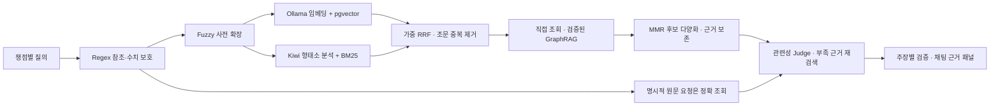

# 기능 상세

README의 기능 요약을 자세히 풀어 쓴 문서입니다. 화면·기능별 동작, 계산기의 지원 범위와 검증 사례, 사용 예시, 한계를 담습니다. 검증 수치의 원본은 [CURRENT_STATUS](ai/CURRENT_STATUS.md)입니다.

[← README로 돌아가기](../README.md)

## 프로젝트 소개

### 국제세무 자료 수집 파일럿 (서비스 미연결)

한–미·한–일·한–중 국제세무 확장을 위한 미국·일본·중국의 공식 법령·안내문과 양자 조약 원문 17건을 별도 파일럿으로 수집했다. 원본·SHA-256·출처·검토용 텍스트는 서비스 DB/임베딩에 넣지 않고 `evaluation/sources/international-tax/`에 보존한다. 적용 시점 및 정답 검수 전이라 현재 채팅은 **한국 세무 서비스**이며 국외 세무를 확정 답변하지 않는다. [수집 결과 및 검수 한계](evaluation/international-tax-pilot-2026-09-25.md).

### 마지막 질문 수정·답변 재생성

긴 세무 답변은 **핵심 판단 → 세목·항목별 검토 → 실무 확인 사항 → 추가 확인 범위와 근거**로 구성합니다. 짧은 질문은 바로 답하며 빈 섹션을 만들지 않습니다. 검증된 핵심 판단은 한 번만 배치하고, 개별 조건은 해당 판단 가까이에 둡니다. 짧은 항목 비교는 표로, 긴 요건·예외는 문단으로 표시합니다. 근거 패널에서 근거 수·쟁점별 확인 상태·답변에 사용한 원문을 펼쳐볼 수 있고, 출처마다 답변이 인용한 원문 구간을 먼저 보여 줍니다. 쟁점마다 판단·요건·예외·세무 효과·사후 조치를 근거가 있는 만큼 다루며 주장 개수 상한은 없습니다. 완료된 조회·계산 내역은 접고 진행·실패 상태는 바로 표시합니다. 답을 기다리는 동안 진행 단계와 경과 시간을 보여 주고, 쟁점마다 검사가 끝나는 대로 통과한 내용부터 먼저 보여 줍니다(보완 검사가 남을 때도 같음).

완료된 마지막 질문 아래의 수정 아이콘, 마지막 답변 아래의 다시 답변 아이콘을 사용할 수 있습니다. 답변 아래 공유 아이콘은 기기의 공유 기능을 열거나, 지원하지 않는 브라우저에서는 해당 답변의 텍스트를 클립보드에 복사합니다. 공개 공유 링크나 서버 측 공유 사본은 만들지 않습니다.
질문 수정은 원본 대화를 보존하고 이전 문맥을 복사한 별도 대화에서 실행합니다. 다시 답변은 같은 대화의 마지막 질문에 새 답변 버전을 추가하며, 이전/다음 버튼으로 저장된 버전을 선택할 수 있습니다. 새 답변 생성이 끝나기 전에는 기존 답변을 DB에서 바꾸지 않습니다.
버전 전환은 후속 질문의 문맥이 뒤섞이지 않도록 마지막 완료 턴에서만 허용합니다. 생성 중에는 사용할 수 없으며, 재생성이 답변의 정확도를 보장하지는 않습니다.
새 요청이 실패해도 원본 대화는 유지됩니다. 과거 중간 질문 수정과 한 대화 내 버전 전환 UI는 지원하지 않습니다.

### 과거 법령 아카이브

과거 법령 원문은 현행 검색과 분리된 `law_history` 아카이브에 저장합니다.
독립 수집기를 `bash dev/law-history-wsl.sh start`로 실행하면 미수집 버전부터 재개하고,
전체 수집 완료 뒤 원문·조문·부칙 무결성 검수를 자동 실행합니다.
실행 상태·보고서 확인과 시점 적용의 한계는 [과거 법령 관리](LAW_HISTORY.md)를 참고하세요.

과거 버전 전용 임베딩·Neo4j 관계·채팅 경로도 분리했습니다.
`법령버전 1063 제16조 원문을 설명해줘`처럼 버전을 지정하거나 법령명과 정확한 기준일을 입력합니다.
연도만 들어간 계산·문서 검색은 기존 도구 경로를 유지합니다. 과거 법령 조회 후 `그럼 제2조는?`은 저장된 법령·버전·기준일을 이어받고, `현행`을 명시하면 현재 법령 경로로 전환합니다.
항·호·목은 보존 XML 구조에서 추출하며 요청한 근거를 우선 확보합니다. 법령명/버전 충돌은 조회를 중단하고, 생성·인용 검증 실패는 완료가 아닌 실패 상태로 표시합니다.
수집한 과거 법령의 전용 벡터 백필은 완료됐습니다(127,838/127,838, 실패 0). 미수집·미준비 버전의 의미 검색은 현행법으로 대체하지 않습니다.
[역사 GraphRAG 구조·검증 기록](HISTORY_RAG.md).
버전별 조·항·호·목, 명시적 정의·인용을 검수한 뒤 과거 법령 검색에만 사용하는
[Knowledge Graph 적재·검수 절차](TAX_KNOWLEDGE_GRAPH.md)도 제공합니다.
수집 완료된 5,400개 과거 스냅샷의 구조 노드·관계 **후보**는 적재했으며, 답변 근거로 쓰는 관계는 별도 승인한 3개뿐입니다. 자동 원문 대조를 법적 의미 검수로 간주하지 않습니다.

### 선택형 GraphRAG

pgvector 검색 결과를 Neo4j의 법령 인용 관계로 보충하는 경로를 구현했습니다.
전체 법령명 인용과 원문에서 정의된 `법`·`영` 약칭을 검증하고, 인용/역방향 인용을 1단계 탐색합니다.
원문·약칭 정의의 버전 해시 대조, 질문 키워드 필터, 추가 본문 총 4,000자 및 3초 제한을 적용합니다. 추가 조문의 고정 개수 제한은 없습니다.
장애 시 기존 검색 결과를 유지하며 `GRAPH_RAG_ENABLED=false`가 기본값입니다.
2026-09-25 로컬 배포는 `.env`에서 `GRAPH_RAG_ENABLED=true`로 활성화했습니다.
WSL 실행 스크립트는 백엔드만 지정해 재빌드할 때에도 현행 또는 과거 GraphRAG가 활성화돼 있으면 Neo4j를 먼저 기동하고 healthy 상태를 기다립니다.
`/api/health/dependencies`의 `graph` 항목에서 연결 상태를 확인할 수 있습니다. 그래프 장애 시 해당 응답은 `degraded`이며 일반 채팅은 기본 벡터 검색 결과를 유지합니다.
일반 채팅의 검색 근거에 반영되며, 별도의 채팅 관계도 UI는 아직 없습니다.
관계가 존재한다는 것이 해당 질문에 법적으로 적용된다는 의미는 아닙니다.
실행·검증·제한은 [GraphRAG 문서](GRAPH_RAG.md)를 참고하세요.

### 해결하려는 문제

일반 LLM에 세무 질문을 하면 세 가지 문제가 발생합니다.

| 문제 | 설명 |
|------|------|
| **환각(Hallucination)** | 존재하지 않는 조문을 생성하거나 조문 번호를 틀리게 인용 |
| **근거 부족** | "~일 수 있습니다" 수준의 모호한 답변, 법령 조문 미인용 |
| **최신성 부족** | 학습 데이터 기준 이후의 개정 세법, 최신 예규·유권해석 미반영 |

### 해결 방법

```
공식 법령 조문 DB (국가법령정보 API, 법령 + 유권해석)
        +
사용자 업로드 PDF (시행령·집행기준 등)
        +
Tavily 웹검색 (공식 사이트 한정, 참고 자료 찾기·공개 사실 확인용)
        +
DB 세율표 기반 세금 계산기
        ↓
Agentic RAG 파이프라인 (검색 → 계산 → 합성 → 인용 검증)
        ↓
법령 조문 번호까지 명시하고 자동 검증까지 거친 근거 기반 답변
```

- **RAG**: 법령 벡터 DB를 먼저 검색하여 근거 없는 생성 차단
- **법령 위계 반영**: 법률 → 시행령 → 시행규칙 → 유권해석 → 집행기준 우선순위 적용
- **Agentic**: 세목 분류·검색 범위 축소를 스스로 판단하고, 계산 의도가 있으면 계산기를 직접 실행하며, 공식 근거가 없을 때만 공식 사이트 웹검색으로 참고 조문을 찾음
- **인용 검증**: 답변 생성 후 조문 인용과 계산 수치를 실제 근거와 자동 대조하는 후처리 단계
- **처리 위치**: 법령 원본 DB와 임베딩은 로컬에 두고, 질문 계획·답변 생성·검사는 OpenRouter 모델로 처리합니다(질문과 검색 발췌가 외부로 전송됩니다).

## 주요 기능

### 법령 데이터 수집 및 검색

- **공식 법령 자동 수집**: 국가법령정보 Open API로 세법 관련 법령 전체 탐색·수집
  - 소득세법, 법인세법, 부가가치세법 등 22개+ 세목 분류
  - 법률·대통령령·총리령·부령 구분 저장
  - 조문 단위 임베딩으로 세밀한 검색 가능
- **문서 업로드**: PDF, DOCX, HWPX, PPTX, HTML 자료의 사용자별 검색
  - 파일명 패턴으로 법령 위계 자동 분류 (AI 호출 없이)
  - 업로드 문서는 구조 경계별 청크(긴 단위만 최대 800토큰 분할); 구형 텍스트 폴백은 800/100 토큰
- **법령해석례(유권해석) 수집**: 국가법령정보 Open API(`target=expc`)로 기획재정부·국세청 등의 유권해석을 수집해 `law_articles`에 `law_type='법령해석례'`로 저장 (법령과 동일한 검색 경로 재사용). 세법 키워드 20개 전수 수집 기준 207건 확보
- **법령 개정 자동 동기화**: 이미 수집된 법령을 재수집해 조문 내용 변경(SHA-256 해시 비교)을 감지하고 구버전을 `is_current=FALSE`로 폐기, 최신 버전만 검색에 노출

### 하이브리드 검색

- 공식 현행 분석: 쟁점별 BM25·조문/항 벡터 → 가중 RRF → 직접 조회·검증 Graph 보충 → MMR → 근거 충족 검사
- 명시적 원문 요청: 법령명·조·항·호·목을 정확 조회하며 무관한 유사 조문으로 넓히지 않음
- 사용자 문서: `user_id`로 격리한 벡터 검색과 확인 가능한 문서 위치 보존
- 과거 법령: 수집된 버전과 검수된 관계를 사용하는 별도 경로. 사건일의 법적 적용 확정과 구분
- 공유 BM25는 사용자 문서·유권해석·과거 원문을 포함하지 않으며 전용 Reranker는 미구현

### Agentic RAG 채팅

- **RAG 파이프라인**: 질문 계획 → 쟁점별 검색·도구 입력 검사 → 근거 충족/재검색 → 주장 생성 → 출처·인용·조건·의미 검사 → 공개된 주장 조립
- **복합·비교 질문**: 요청한 주체와 세목·판단 항목을 나누고 각 쟁점의 근거와 제한을 함께 설명. 확인된 범위만 공개하며 부족한 항목을 별도로 표시
- **세금 계산기 tool calling**: 질문에서 계산 의도를 감지하면 세목별 결정적 해석기가 계산기 입력을 읽어 DB 세율표 기반 계산기를 실행하고, 계산 과정과 근거 조문을 답변에 반영합니다. 해석기가 사실을 다 읽지 못하면(되묻기, 해석 불가, 계산에 쓰이지 않은 금액) 모델이 대화 전체를 한 번 읽어 사실마다 사용자 말을 인용하고, 코드가 그 인용에서 금액·날짜·연수·단서 단어를 확인한 사실만 계산에 씁니다("2014년 매입해서 2019년까지 거주", "서초구 반포동", 직전 질문에 대한 "네"). 날짜로 말한 기간은 코드가 세고, 2017년 8월 2일 이전 취득은 거주요건을 묻지 않으며, 주소는 조정대상지역 지정 이력 표로 판단합니다(표 밖의 지정·해제와 주식 상장 여부는 공식 사이트 검색으로 찾고 출처를 밝힙니다). 세액을 가르는 사실을 모르면 최대 4가지 경우를 계산해 경우별 세액을 보이고 어느 경우인지 묻습니다(모든 경우가 같으면 그 세액이 답입니다). 금액이 없어 계산할 수 없으면 첫 질문에서 근거 답변으로 규칙을 설명하고 필요한 사실을 묻습니다. "그럼 7천만원이면?"처럼 금액만 바꾼 후속 질문은 직전 질문의 금액을 바꿔 다시 계산합니다(금액이 여럿이면 말의 뜻으로 고르고, 모르면 묻습니다). 6개 세목은 모델 도구 선택을 부르지 않습니다. 해석기가 읽지 못한 조건(국외 자산, 창업자금 특례 등)에 금액이 있으면 공식 근거 참고 계산으로, 금액이 없으면 필요한 사실을 한국어로 묻습니다. 되물은 사실에 답하면("거주 10년이야") 앞 질문과 합쳐 계산을 이어 갑니다. "2025년 귀속"·양도일·증여일처럼 과세 사건의 날짜를 말하면 그날 시행 세법으로 계산하고, 결과에 적용 세법 기준일을 표시합니다(세율표는 2021-01-01부터 수록했습니다. 2021-07-01 개편 전 간이과세와 2021-06-01 전 분양권, 그리고 2021년 전 날짜는 계산하지 않고 알립니다). 모델 도구 선택은 6개 세목 밖의 계산(취득세 등)과 원문·문서 조회에만 씁니다.
- **인용·금액 검증**: 공식 원본 ID·시행일·해시·원문 구간과 계산 결과를 대조합니다. 실패한 주장·의존 결론은 제외하고 검증된 독립 항목은 보존합니다.
- **SSE 응답**: 도구 실행 상태를 전달하고, 생성한 답변은 검증이 끝난 뒤 한 번에 전달·저장합니다.
- **대화 메모리**: 최근 3턴 컨텍스트 유지, 대화별 독립 세션(conversations 테이블)
- **Tavily 웹검색**: 공공기관 중심의 보충 경로. 쟁점 분석은 먼저 부족한 공식 근거를 재검색하며 웹 스니펫을 그대로 공식 인용으로 채택하지 않습니다.

### 세금 계산기

- **전용 계산기 밖의 채팅 참고 계산**: 전용 계산기가 읽지 못한 금융소득 질문 등은 공식 법령 수집 → 제한된 JSON 산식 → Decimal 연산 → 수치·근거 검사와 필수 의미 Judge를 거칩니다. 승인된 결과만 예시 가정/계산 범위와 함께 제공하고, 웹의 **근거 및 확인 사항 → 계산에 사용한 값과 산식**에서 입력 출처와 전체 계산을 확인할 수 있습니다. 검증되지 않은 산식은 공개하지 않고 근거 설명을 계속합니다. 확보한 시행본 기준의 참고 계산이며 과거 시점 적용이나 신고세액 확정은 지원하지 않습니다.
- **실패와 0원 결과 분리**: 필수 세율·공제 데이터가 없거나 DB 연결이 실패하면 계산을 중단한다. 입력 오류·미지원 조건·일시 장애를 구분해 화면과 채팅 도구 카드에 안내하며, 실패한 계산을 LLM이 임의로 보완하지 않도록 최종 생성을 우회한다. 정상적인 0원 및 부가세 환급 결과는 유지한다.

- 세목·과세 단위별 6종: 종합소득세(금융소득·가상자산 포함)·퇴직소득세·양도소득세·상속세·증여세·부가가치세, DB 세율표(`tax_brackets`/`tax_deductions`) 기반 계산
- **가산세 옵션**(6개 계산기 공통, `penalty_type` 등): 무신고·과소신고·납부지연을 고르면 그 계산기가 구한 납부할 세액(과소신고는 처음 신고한 세액, 납부지연은 이미 낸 세액을 뺀 금액)에 가산세를 붙여 추가로 낼 금액을 보입니다. 무신고에는 증여세·상속세 신고세액공제와 부가가치세 전자신고세액공제를 빼고 계산합니다. 과소신고는 처음 신고한 과세표준을 넣으면 신고세액공제를 그 부분에만 주고(상속세 및 증여세법 시행령 제65조의2), 부가가치세는 덜 신고한 영세율 매출의 0.5%(무신고는 영세율 매출 전체) 가산세를 더합니다. 채팅에서 "신고를 안 했고 2개월 지났어"처럼 말하면 세목 계산기에 이 옵션이 붙고, 본세 금액만 말한 가산세 질문("종합소득세 500만원을 신고 안 했는데 가산세 얼마?")은 가산세만 계산합니다.
- 양도소득세(`capital_gains`, 국내 부동산 1건): 1세대 1주택 비과세(보유 2년, 취득 당시 조정대상지역이면 거주 2년)와 12억원 초과 고가주택 안분(시행령 제160조), 장기보유특별공제 표1(연 2%, 최대 30%)·표2(보유·거주 각 연 4%, 최대 80%), 단기보유 세율(주택 70%·60%, 그 밖 50%·40%), 조정대상지역 다주택 중과(입력으로 2주택 +20%p·3주택 이상 +30%p, 장기보유특별공제 배제)를 계산합니다. 결정세액은 양도소득세(국세)이고 지방소득세(10%)는 별도 단계로 표시합니다. 산식은 국세청 양도소득세 신고서 작성 사례·고가주택 계산 안내·「2026 세금절약가이드 Ⅱ」 세율 비교표 9건으로 검증합니다. 채팅의 부동산 양도 계산 질문은 이 계산기를 먼저 쓰며, 1세대 1주택 여부·거주기간·취득 당시 조정대상지역 여부처럼 비과세를 가르는 사실은 가정하지 않고 되묻습니다(필요경비만 0원 가정으로 밝힘). 다주택은 취득 당시 조정대상지역 여부와 중과 적용 여부를, 주식은 대주주 여부와 거래 시장을 되묻습니다. 계산기 화면은 1조합원입주권 비과세(원조합원, 12억원 초과분 안분)와 같은 해 여러 건 양도의 비교과세(제104조 제5항: 과세표준 합계 x 기본세율과 자산별 세율 합계 중 큰 금액)도 입력받습니다. 국외 부동산은 일반 도구 경로로 갑니다.
- 그 밖의 소득·자산: 종합소득세는 주택 보증금 간주임대료((보증금 - 3억원) x 60% x 정기예금이자율 3.1%, 3주택 이상·3억원 초과 또는 2주택·12억원 초과), 종교인소득(필요경비 80~20% 표, 근로소득 신고 선택), 공적·사적연금(연금소득공제, 사적연금 분리과세 3~5%·15%와 종합과세 비교), 기타소득(강연료·원고료 60%·상금 80% 필요경비 의제, 300만원 이하 분리과세 비교), 주택임대소득(2천만원 이하 14% 분리과세 비교), 추계 사업소득(단순경비율 기본율·초과율, 기준경비율과 배율 2.8·3.4), 일용근로소득(분리과세)을 계산하고 법이 고르게 하는 분리과세는 세금이 적은 쪽을 고릅니다. 양도소득세는 분양권·조합원입주권·기타자산(회원권)·비사업용 토지·미등기와 주식(대주주·소액·국외·중소기업), 파생상품, 신탁수익권을 네 소득 그룹별 기본공제·손익 통산으로 계산합니다.
- 퇴직소득세(`retirement`): 근속연수공제(2016년·2023년 표), 환산급여공제, 기본세율, 근속연수 연분연승으로 계산합니다. 국세청 퇴직소득 안내 사례로 검증합니다. 연금계좌(IRP 등)로 옮긴 퇴직급여는 그 몫의 퇴직소득세를 미루고(제146조 제2항), 연금으로 받을 때 연금외수령 원천징수세율의 70%(실제 수령 10년 이하)·60%·50%로 낼 세금을 함께 보입니다. 2016~2019년 퇴직분의 신·구 계산 안분은 경정청구 기한(5년)이 지나 실익이 적어 지원하지 않습니다.
- 가상자산(종합소득세 계산기의 `virtual_*` 입력): 2027년 1월 1일 양도분부터 (소득금액 - 250만원) x 20% 분리과세이고 2027년 전 보유분은 2026-12-31 시가와 비교합니다. 다른 소득과 합산하지 않는 분리과세 세액으로 결정세액에 더합니다. 그 전 양도는 과세되지 않음과 2027년 이후 세액을 함께 보입니다. 공식 계산 사례가 아직 없어 법조문 산식으로 검증합니다. 대여·스테이킹·코인 간 교환은 일반 도구 경로로 갑니다.
- 부가가치세(`vat`, 과세기간 1회 신고분): 일반과세자는 매출세액(과세 10%·영세율 0%) - 공제 매입세액(불공제·공통매입 면세비율 안분 차감) - 음식점 개인사업자 의제매입세액(9/109·8/108, 과세표준 비율 한도) - 신용카드매출전표등 발행세액공제(1.3%, 연 1천만원 한도, 납부세액 한도) - 전자신고세액공제 - 예정고지세액, 간이과세자는 공급대가 x 업종별 부가가치율(15~40%) x 10% - 매입 공급대가 0.5% - 카드 발행공제(공제 합계는 납부세액 한도, 환급 없음), 연 공급대가 4,800만원 미만 납부의무 면제를 계산합니다. 산식은 국세청 2022년 확정신고 작성방법의 일반과세자 6개·간이과세자 4개 업종 사례로 검증합니다. 채팅은 과세유형과 간이과세자 업종이 없으면 되묻습니다.
- 가산세 산식(`penalty_tax`, 위 옵션과 본세만 말한 채팅·상담이 함께 씀): 무신고(20%, 부정 40%, 복식부기의무자·법인 수입금액 1만분의 7·14 하한)·과소신고(10%, 부정 40%) 가산세에 기한 후 신고(1·3·6개월 50·30·20%)·수정신고(1개월~2년 90~10%) 감면을 적용하고 납부지연가산세(1일 0.022%)를 함께 계산합니다. 산식은 「2026 세금절약가이드 Ⅱ」 무신고 사례와 종합소득세 신고서 작성사례의 수입금액 기준 무신고가산세로 검증합니다. 채팅은 무신고·과소신고·납부지연 구분과 지연 기간이 없으면 되묻습니다.
- 상속세(`inheritance`, 거주자 사망): 채무·공과금과 장례비용(최소 500만원·한도 1천만원+봉안 500만원)을 빼고 사전증여재산(상속인 10년·그 외 5년)을 더한 과세가액에서 기초·그 밖의 인적공제(자녀·미성년·65세 이상·장애인)와 일괄공제 중 큰 금액(배우자 단독상속이면 일괄공제 없음), 배우자 상속공제(실제 상속액, 최소 5억원, 법정상속분 기준 한도와 30억원), 금융재산 상속공제(20%·최소 2천만원·한도 2억원)를 빼고 공제 적용 한도(제24조)를 적용합니다. 세대생략 할증(손자녀 몫 비율), 증여세액공제, 과세최저한, 신고세액공제 3%까지 계산합니다. 산식은 국세청 상속세 신고서 작성 사례 2건과 「2026 세금절약가이드 Ⅱ」 사례 4건으로 검증합니다. 채팅의 상속세 계산 질문은 이 계산기를 먼저 쓰며, 배우자 유무·자녀 수·미성년 상속인의 나이·언급된 사전증여액은 되묻고, 말하지 않은 배우자 실제 상속액·금융재산 등은 세금을 줄이지 않는 쪽으로 가정해 밝힙니다. 손자녀 상속·상속포기·유증·가업·영농 등은 일반 도구 경로로 갑니다.
- 증여세(`gift`, 증여 1건): 인수 채무(부담부증여)를 빼고 10년 내 동일인(직계존속은 그 배우자 포함) 증여를 합산하며, 관계별 10년 증여재산공제(이미 다른 증여에 쓴 공제 차감), 혼인·출산 증여재산공제(2024년 이후, 평생 1억원), 과세최저한 50만원, 세대생략 할증(30%, 미성년·20억 초과 40%), 합산한 이전 증여의 기납부세액공제(이전 산출세액과 과세표준 비율 한도 중 작은 금액, 모르면 현행 기준 추정을 밝힘), 신고세액공제 3%를 계산합니다. 산식은 국세청 증여세 신고서 작성 사례 5건(6개 계산)과 「2026 세금절약가이드 Ⅱ」 사례 2건으로 검증합니다. 채팅의 증여세 계산 질문은 이 계산기를 먼저 쓰며, 관계·미성년 여부·혼인·출산 2년 요건·언급된 이전 증여액은 되묻고, 창업자금·가업승계·영농·비상장 주식 등은 일반 도구 경로로 갑니다.
- 종합소득세(`income_tax`, 금융소득 종합과세 포함): 근로소득 총급여(근로소득공제 제47조), 사업소득 수입금액·필요경비, 연금·기타 등 그 밖의 소득금액, 이자·비영업대금이익·배당을 한 계산에 넣습니다. 금융소득은 종합과세기준금액(제14조)·배당가산(제17조)·비교과세(제62조)·배당세액공제(제56조)로 산출세액을 정하고, 세액공제는 소득 종류에 맞게 적용합니다: 근로소득세액공제(제59조, 근로소득분 산출세액 안분과 총급여별 한도), 표준세액공제(제59조의4 제9항: 근로소득자 13만원, 성실사업자 12만원, 그 밖 7만원, 특별공제 신청 시 없음, 원천징수세율로 과세된 금융소득분 제외 한도 제61조 제2항), 입력한 그 밖의 세액공제와 기납부세액. 법정 수치는 DB에서 읽고 산식은 국세청 종합소득세 신고서 작성사례 9건과 「2026 세금절약가이드 Ⅰ」 사례 2건, 「2022년 귀속 금융소득종합과세 해설」 사례 5건으로 검증합니다. 채팅의 종합소득세·금융소득 계산 질문은 이 계산기를 먼저 쓰며, 소득 종류(근로·사업·기타 등), 사업 필요경비, 근로소득금액만 말한 경우의 총급여, 단위가 모호한 '7천' 같은 금액은 되묻고, 부양가족·그 밖의 공제·이미 낸 세금처럼 세금을 줄이기만 하는 값은 없다고 보아 결과 앞에 밝힙니다. 이전 `financial_income_tax` 도구·API는 같은 계산의 별칭입니다.
- 계산 단계·근거 조문을 함께 반환, 프론트 계산기 화면과 챗봇 tool calling 양쪽에서 재사용
- **계산기 ↔ 챗봇 왕복 연결**: 챗봇이 계산기를 실행하면 답변에 "계산기에서 조건 바꿔보기" 버튼(입력값 프리필), 계산기 결과에서 "이 결과에 대해 챗봇에게 질문하기" 버튼으로 상호 이동

### 세무 일정 관리

- 사업자 유형(법인/개인 일반과세/개인 간이과세)에 따른 부가가치세·종합소득세·원천세 신고 기한을 규칙 기반으로 계산 (LLM 미사용)
- 프로필 화면에서 사업자 유형 설정 시 다가오는 신고 기한이 D-day와 함께 표시

### 조문 원문 뷰어

- 답변에 인용된 "[법률] 소득세법 제55조" 등의 조문을 클릭하면 사이드패널에 DB의 조문 원문이 열림
- 검증된 인용을 눈으로 직접 확인할 수 있는 UX로 "근거 기반 답변"을 체감 가능하게 함

### RAG 품질 평가 도구

- `scripts/evaluate.py`: 버전 관리된 평가셋·hard negative·단계별 자동 판정·인간 검수·회귀 비교를 통합한 평가 CLI. [판정 규약](../evaluation/README.md)
- `scripts/evaluate.py langsmith`: 평가 결과를 LangSmith 실험·검수 큐로 명시적 전송합니다. 채팅 실행 추적은 별도 `CHAT_TRACING_ENABLED` 설정으로 동작합니다. [설정·사용법](../evaluation/LANGSMITH.md)
- 파라미터(임계값, 프롬프트 등) 변경 시 효과를 수치로 검증 가능
- `--repeat N` 옵션으로 동일 평가를 반복 실행해 생성 품질 지표의 샘플링 편차와 실행마다 결과가 바뀌는 비결정적 항목을 확인 가능

### 기타

- JWT httpOnly 쿠키 기반 인증
- React 채팅 UI (마크다운 렌더링)

## 사용 예시

### 세무 질문 예시

```
# 부가가치세
"간이과세자의 부가가치세 신고 기준은 어떻게 되나요?"
"매입세액 불공제 대상을 알려주세요."

# 소득세
"근로소득공제는 어떤 기준으로 적용되나요?"
"소득세법상 필요경비 인정 기준을 알려줘."
"프리랜서의 원천징수 세율이 궁금합니다."

# 법인세
"법인의 접대비 한도는 어떻게 계산하나요?"
"결손금 소급공제 신청 방법을 알려주세요."

# 세무 절차
"경정청구 기한은 얼마나 되나요?"
"세금계산서 발급 의무가 없는 경우는 어떤 경우인가요?"

# 계산 질문 (세금 계산기 tool calling 자동 실행)
"연봉 5천만원이면 종합소득세 얼마야?"
"수입 1억, 경비 6천만원, 부양가족 2명이면 종합소득세 계산해줘"
"성인인 아들에게 3억 증여하면 증여세 얼마야?"
"10년 보유한 아파트를 12억에 팔고 취득가는 7억이면 양도세 계산해줘"
"해외주식을 5천만원에 사서 1억에 팔면 양도세 얼마?"
"국민연금 연금소득 1,200만원이면 종합소득세 얼마?"
"퇴직금 1억 받으면 퇴직소득세 얼마야? 20년 근무했어"
"비트코인을 1천만원에 사서 5천만원에 팔면 세금 얼마?"
"성인 아들에게 3억 증여했는데 신고를 안 했어. 기한이 1개월 지났어. 증여세 얼마야?"
```

### 답변 구조

일반 분석 답변의 구조는 질문 길이와 공개된 주장에 따라 달라집니다. 아래는 긴 복합 질문의 **표시 형식 예시**이며, 고정 목차나 세무 판단 예시가 아닙니다.

```markdown
## 핵심 판단
공개 승인된 직접 답변과 그 판단을 제한하는 조건

## 해당 주체 · 세목
판단 이유, 적용 요건과 예외
항목이 여러 개면 짧은 비교표 또는 항목별 소제목

### 신고·처리 절차
요청한 업무의 순서와 처리 기준

## 실무 확인 사항
자료와 확인 목적, 필요한 후속 조치

## 추가 확인이 필요한 부분
확보하지 못한 근거 또는 추가로 필요한 조건

**확인한 근거**
공개된 주장에 연결된 공식 원문 링크
```

최초 생성의 `presentation_role`로 구분하며, 코드/인용/Judge 검사를 통과한 문장만 배치합니다. 별도 요약 모델로 내용을 다시 쓰지 않습니다. 근거 패널은 인용·계산·적용 범위와 저장된 원문을 구분해 보여주며, 계산과 무관한 질문에 계산 미사용 문구를 나열하지 않습니다. 확인 상태는 세무 정확성 인증이 아닙니다. 새 질문/다시 답변부터 적용되고 기존 답변 내용은 수정하지 않습니다.

## 한계 및 개선 과제

### 복합 질문의 답변이 중간에 끝나는 경우

현재 OpenRouter 답변의 출력 길이 중단은 제한된 이어쓰기 정책을 따릅니다. 일반 분석은 쟁점별 생성·검사 예산 안에서 공개 가능한 부분을 보존하며, 미완료·검사 실패를 정상 완료로 표시하지 않습니다. 출력 길이·계정 429·응답 시간 제한·근거 부족은 원인을 구분해 확인합니다. 로컬 Ollama의 4,096토큰 `num_ctx` 설정은 선택형 Ollama 생성에만 해당합니다.

| 한계 | 개선 방향 |
|------|-----------|
| 스캔 PDF의 OCR 오인식·20쪽 제한 | 원본 대조 평가, OCR 품질 향상 및 비동기 대용량 처리 |
| 이미지형 DOCX/HWPX/PPTX와 바이너리 HWP 미지원 | 형식별 이미지 OCR·HWP 변환 경로를 별도 검증 후 추가 |
| 구조화 청킹을 해도 OCR·표/제목 판별은 불완전 | 형식별 원문 위치·숫자·표 골든셋으로 검수 |
| 전용 Reranker 미구현 | 후보 풀 유지·전용 모델·shadow 비교 후 적용 |
| 공유 BM25는 공식 현행 법령에 한정 | 권한을 유지하는 사용자 문서·과거/해석 자료의 유형별 검색 확대 |
| 일반 상담의 과거 법령 적용 미확정 | 사건일별 시행본·부칙 연결과 적용 조건 검수 |
| 현재 평가 라벨은 개발용, Judge 독립 교정 미완료 | 전문가 holdout·오답 통과/정상 차단·쟁점 완결성 비교 |
| 유권해석 안건명에서 관련 법령을 첫 번째 「」만 추출 | 본문 전체를 분석해 가장 관련도 높은 법령을 선택하도록 개선 여지 |
| 업로드 문서의 금액·자격 자동 확정 미지원 | OCR 결과의 원본 대조와 정형 필드 검수 절차 추가 |

## 기능 추가 기록

기능을 추가한 날짜별 설명입니다. 그 뒤에 바뀐 내용이 있을 수 있으며, 지금 상태는 [현재 상태](ai/CURRENT_STATUS.md)를 따릅니다.

### 자동 질문·평가 카드 (2026-10-04)

`scripts/evaluate.py auto pipeline`은 보관된 공식 XML에서 규칙과 합성 세무 질문/평가 기준을 만들고,
코드 검사·별도 원문 감사 후 채택한 카드의 **질문만** 실제 채팅에 전달합니다. 검색/생성 입력/답변을
관측해 항목별 Judge를 실행하고 `--publish`로 LangSmith Dataset/Experiment/Feedback을 자동 게시합니다.
기본 범위는 6세목 × 5유형의 30개 생성 시도이며 실패/판단 불가 카드는 제외 사유를 남깁니다.
모델은 원문/답변 구간 ID를 선택하고 서버가 정확한 발췌를 복원합니다. `--resume`은 완료 단계의
중복 실행을 막고 `run --from-run`은 같은 저장 답변만 새 Judge로 평가합니다.

```bash
docker exec tax_backend python scripts/evaluate.py auto pipeline \
  --output /tmp/auto-evaluation-NEW --as-of 2026-10-04 --types general --publish
docker cp tax_backend:/tmp/auto-evaluation-NEW evaluation/runs/auto-evaluation-NEW
```

자동 카드는 인간 승인 정답셋이 아니며 기존 승인 gate는 유지합니다. R2 미라벨 후보·G1 독립 감사·T1 숫자 기대값의 한계와 실제 검증 결과는 [사용법](../evaluation/AUTO_EVALUATION.md), [현재 상태](ai/CURRENT_STATUS.md)를 참고하세요.

### 공식 법령 Hybrid RAG (2026-09-30)

일반 분석·복합 질문과 참고 계산의 쟁점 검색에 **Ollama Qwen3 벡터 + 한국어 BM25 + GraphRAG**, **Fuzzy·Regex·MMR**을 적용한다. 생성·Judge는 기존 OpenRouter GPT-6 Luna를 유지한다.



- BM25는 형태소의 희소도(IDF), 빈도 포화(TF), 조문 길이를 반영한다. 제목·본문은 각각 BM25를 계산해 `제목 × 2 + 본문`으로 합한다. 벡터 코사인·BM25·RRF 점수는 별도로 보존하며 코사인 임계값을 BM25에 적용하지 않는다.
- 두 벡터 질의와 첫 질의의 BM25를 병렬 실행한다. 각 경로 15개 후보를 RRF `k=10`, 벡터 각 1/BM25 0.5로 결합해 8개를 채택한다. 기존 제목 보완 최대 2개와 주 질의의 상위 공식 조문 보존 최대 2개를 추가하고, 직접 조회·그래프의 기존 원문/예산 제한을 적용한다. 후보 채택은 법적 관련성 승인과 구별한다.
- PostgreSQL 공식 현행 원문에서 프로세스별 읽기 전용 역색인을 만든다. 같은 시행본의 검증된 XML로 누락 본문을 복구해 색인하고, 미래 시행·무결성 실패·복구 불가한 호 누락 자료는 제외한다. 반환 직전에 원본 행·해시·세목·시행일을 다시 대조한다. 사용자 업로드·과거 시점 검색·유권해석은 이 공유 BM25 색인에 포함하지 않는다.
- 시작 때 백그라운드로 준비하고 60초마다 DB revision을 확인한다. 원문 변경은 새 색인 완성 후 교체하며 갱신 실패 시 이전 색인 중 유효한 자료만 반환한다. 준비 대기/실패에는 기존 pg_trgm 키워드 검색으로 돌아가며, 벡터 경로 장애도 다른 경로의 정상 후보를 막지 않는다.
- 날짜가 바뀌면 DB 수정 없이 새로 시행되는 조문도 색인 갱신 대상으로 삼는다. 직접 조회는 정해진 법령 약칭(상증세법·부가세법·조특법·국기법)을 정식명으로 연결하며, 임의로 비슷한 법령명을 선택하지 않는다.
- Fuzzy는 고정 세무 사전의 유일한 1회 편집 후보만 최대 2개 검색어로 덧붙인다. 원 질문·명시적 법령/조문·금액·날짜·부정 의미는 유지한다. Regex는 가지번호/항/호/목과 복수 조문을 구별하고, 원문만 묻는 요청을 정확 조회로 제한한다. 자유 입력 정규식 검색이나 날짜의 법적 적용 승인은 제공하지 않는다.
- MMR은 쟁점별 후보의 실제 부모 벡터로 중복도를 계산해 재정렬한다. 상위 2개와 직접 조회·그래프·보완 후보의 기존 위치를 고정하고 다른 후보만 정렬한다. 모든 근거 후보를 유지하며 별도 모델 호출은 추가하지 않는다.
- 질의 임베딩은 제공자·주소·모델·버전·질의로 구분해 최대 512개/600초 보관한다. 같은 동시 배치 호출은 한 번만 실행하며 실패 결과는 저장하지 않는다. XML 파싱 캐시는 검증된 스냅샷 해시 기준 최대 24개다. 그래프 조문 조회는 같은 요청에서 중복을 없애고 동시 4개로 제한한다.
- BM25 자체는 기존 PostgreSQL 테이블을 읽고 프로세스별 색인을 만든다. 원문 보정에는 아래의 벡터 입력 이력 스키마를 사용한다. 형태소 분석기 때문에 이미지와 프로세스 메모리가 늘며 worker마다 색인을 보유한다. 최초 색인은 로컬 실험에서 약 39~42초였고 이 시간은 질문별 검색 지표와 분리한다. 현행 법령 수가 크게 늘면 PostgreSQL BM25 확장/OpenSearch 등 외부 역색인과 비교해야 한다.

설정은 `SEARCH_LEXICAL_BACKEND=bm25|trigram`(기본 bm25), `SEARCH_BM25_REFRESH_SEC=60`, `SEARCH_BM25_TITLE_WEIGHT=2`, `SEARCH_RRF_K=10`, `SEARCH_LEXICAL_WEIGHT=0.5`, `SEARCH_EMBED_CACHE_SIZE=512`, `SEARCH_EMBED_CACHE_TTL_SEC=600`이다. TTL/size를 0으로 두면 해당 임베딩 캐시는 재사용하지 않는다. 기존 `pg_trgm` 인덱스는 fallback에 사용한다.

`SEARCH_FUZZY_ENABLED`, `SEARCH_REGEX_ENABLED`, `SEARCH_MMR_ENABLED`는 기본 true이며 개별 비활성화할 수 있다. `SEARCH_MMR_LAMBDA=0.85`(0~1)로 순위 관련성과 다양성의 비중을 조정한다. 신규 Alembic `20260930_0010`은 공식 부모/항 벡터의 실제 입력 이력을 `index_metadata`에 기록한다.

로컬 진단: 최신 컨테이너에서 `python evaluation/issue_retrieval_probe.py /tmp/trigram.json --all --trigram`, `python evaluation/issue_retrieval_probe.py /tmp/bm25.json --all`. BM25 색인은 측정 전에 준비한다. 기본적으로 LangSmith 게시를 끄고 `--trace`로 명시적으로 켤 수 있다. 운영 채팅의 `issue_hybrid_retrieval`에는 출처 ID·경로별 점수·캐시·단계별 시간·fallback을 남기며, 검색 trace 자체에는 질문/원문 전체를 넣지 않는다.

39개 draft/dev 질문 중 필수 라벨이 있는 38개에서 기존 pg_trgm 결합 대비 최종 BM25 결합은 후보 확보 **38/38 유지**, MRR **0.730→0.756**, 검색 P50 **0.474→0.365초**, P95 **0.725→0.422초**, hard negative 후보 **4건 동일**, 실행 오류 **0**이었다. 단일 로컬 실행이며 개발 라벨로 순위 설정을 조정했으므로 독립 holdout/세무 정답률은 아니다. BM25 첫 질의는 5.645초였고 초기 색인 준비는 별도다. 실험 JSON은 Git 제외 `evaluation/runs/hybrid-bm25-20260930/`에 보관한다.

원문·색인 보정은 같은 시행본 공식 보관 XML만 사용한다. 고정 계획·원본/벡터/항 백업·임베딩 사전 준비·부모 행 잠금/대조·transaction 교체·rollback을 지원한다. 다른 시행본이나 모델 추측으로 원문을 대체하지 않는다. 운영 평가는 LangSmith이며 관리자 화면은 추가하지 않는다.

다음 명령은 백엔드 컨테이너에서 실행한다. 각 보정은 새로운 디렉터리에 계획/백업을 저장하고 컨테이너 재생성 전에 호스트에 보존해야 한다. `apply` 기본값은 20행 파일럿이며 `--limit 0`은 계획 전체 적용이다.

```bash
python scripts/repair_law_indexes.py preview --plan /tmp/law-repair/plan.json --scope all --include-clauses --graph-backup
python scripts/repair_law_indexes.py apply --plan /tmp/law-repair/plan.json
python scripts/repair_law_indexes.py apply --plan /tmp/law-repair/plan.json --limit 0
python evaluation/index_repair_audit.py
python scripts/sync_law_graph.py --all --apply
python scripts/audit_law_graph.py
```

`rollback --plan <동일 계획>`은 해당 실행의 원문/벡터/항을 백업으로 복원한다. 후속 변경이 있으면 거부하며, 복원 후 현행 그래프를 다시 동기화한다. `--all --apply` 그래프 동기화는 현행 `TaxArticle`의 오래된 키를 정리하고 별도 역사 스냅샷은 유지한다.

알고리즘 비교 진단은 `python evaluation/issue_retrieval_probe.py /tmp/baseline.json --all --no-algorithms`, 같은 명령의 플래그 없는 실행, `python evaluation/search_algorithms_probe.py /tmp/algorithms.json`을 사용한다. 마지막 명령은 오타·복수/인용 조문·알 수 없는 법령·부정 의미를 같은 코퍼스로 비교한다. draft 라벨은 독립적인 세무 정답 평가가 아니다. 최신 실행 결과와 남은 제한은 `docs/ai/CURRENT_STATUS.md`와 `HANDOFF.md`를 따른다.

2026-10-01까지 원문 복원 1,503개와 누락 항 색인 생성 1,471개를 처리했다. 보정한 2,974개 조문/13,203개 항의 입력 이력·구조 감사 오류 0, 현행 전체 6,675개 조문/16,437개 항의 활성 벡터 누락과 항 미생성 0이다. 그래프는 6,675노드/11,216인용 관계로 맞췄다. 동일 시행본 복구가 확인되지 않은 누락 의심 27행은 별도 검수 대상으로 남겼으며 다른 버전으로 교체하지 않았다.

같은 보정 코퍼스의 39개 draft 질문에서 세 알고리즘 적용 전후 필수 근거 38/38·MRR 0.746053을 유지하고 hard negative 후보 5→4, P50 0.380→0.362초/P95 0.429→0.374초를 측정했다. 별도 오타/복수 참조 등 16입력에서는 필수 근거 13/15→15/15, 원문 조회의 요청 외 후보 23→0이었다. 단일 개발 진단이며 독립 holdout/세무 정답률은 아니다.

검색 변경 당시 최종 이미지 전체 백엔드 테스트는 **956 passed, 2 skipped, 5 subtests passed**였다. 실제 증여 공제·신고·서류 질문 6/6 주장 공개·limited, 부가가치세 요건/불공제 질문 4/4 공개·checked, 두 Judge 오류 0이었다. 이 검색 스모크와 이후 답변 표시 변경의 969개 테스트 기록을 구분한다. 새 질문/다시 답변에 적용되며 세무 정답/완결성 인증을 뜻하지 않는다.

### 다양한 문서 형식의 사용자 RAG (2026-09-26)

내 문서에서 **PDF(텍스트·스캔 OCR), DOCX, HWPX, PPTX, HTML/HTM**을 업로드할 수 있습니다. 형식별 추출 결과를 페이지·슬라이드·구역·제목·문단·표 행·명시적 조/항/호 경계의 구조화 청크로 만든 뒤 Qwen3 임베딩 → 사용자별 pgvector 검색 경로에 저장합니다. PDF는 텍스트가 부족한 페이지만 한국어·영어 Tesseract OCR을 실행합니다. 검색 근거에 확인 가능한 페이지·슬라이드·표 행 위치를 표시하며, 원본은 사용자별로 보관합니다. HTML 등 비-PDF 원본은 실행되지 않도록 다운로드만 허용합니다.

기본 제한은 파일당 50MB, PDF 200쪽 중 OCR 최대 20쪽, 추출 텍스트 50만 자입니다. 구형 바이너리 HWP와 이미지형 DOCX/HWPX/PPTX의 OCR은 지원하지 않습니다. PDF/OCR에서는 표 셀 경계를 신뢰성 있게 식별하지 못하므로 PDF 표를 구조화된 행으로 보증하지 않습니다. OCR 결과의 숫자·날짜·세무 사실은 반드시 원본과 대조해야 합니다. 기존 업로드는 자동 재청킹되지 않으며 새 구조를 적용하려면 재업로드해야 합니다. `PYTHONPATH=. python dev/probe_document_formats.py`로 임시 계정의 다섯 형식 업로드·OCR·벡터·검색을 검증할 수 있습니다.

내 문서 화면에서는 지원 형식의 파일 선택 또는 끌어놓기를 제공하고, 업로드 전 확장자·빈 파일·50MB 제한을 확인합니다. 완료 시 생성된 청크 수와 OCR 쪽 수를 표시하며, 목록의 `구조화 검색` 표시는 신규 업로드의 `chunking_version=2` 메타데이터가 있을 때만 보여줍니다. 이전 문서는 `기존 청킹`으로 표시하고 재업로드를 안내합니다. 같은 이름으로 재업로드하면 원본·검색 청크와 저장된 문서 검토값이 교체됩니다.

### 상담 이후의 업무 화면 (2026-09-26)

- **상담 보고서:** 상담별 현재 입력, 서류 체크리스트, 저장된 참고 계산 및 표시 근거를 한국어 PDF로 다운로드합니다. 법적 판단·신고서가 아니라 검토용 기록입니다.
- **문서 원본 검토:** 새로 업로드한 PDF 원본을 화면에서 보면서 텍스트에서 추출한 금액·날짜 후보와 대조합니다. 사용자가 금액·날짜와 원본 페이지를 확인해 저장하며, 금액만 명시적으로 연결된 상담 입력에 반영할 수 있습니다. 확인한 날짜는 상담 기준일을 자동 변경하지 않습니다. 스캔 PDF OCR은 RAG 색인에 사용하지만 검토 화면의 금액·날짜 후보는 아직 텍스트 레이어 기반이므로 직접 확인·입력해야 합니다. 기존 업로드 원본은 소급 복원되지 않습니다.
- **계산 시나리오:** 같은 상담에서 계산 결과를 최대 30개 저장하고 세액·계산 단계 차이를 비교합니다. 입력을 바꾸면 현재 계산은 무효화되지만 저장한 시나리오는 유지됩니다.
- **법령 탐색:** 수집된 법령의 기준일별 버전과 조문 원문을 조회하고 두 기준일의 같은 조문을 비교합니다. 검수된 원문 인용 관계만 표시하며, 수집되지 않은 버전이나 조문은 현행법으로 대체하지 않습니다.
- **개인 세무일정:** 국세청 공식 일정에서 선택한 항목만 내 준비 목록에 저장하고 `확인 예정/준비 중/완료/해당 없음`으로 관리합니다. 30일 이내의 미완료 항목을 화면에 표시하지만 푸시 알림, 실제 신고·납부 확인, 개인별 의무 판정은 제공하지 않습니다.

Alembic `20260926_0008`이 원본 PDF·검토값·시나리오·개인 일정 테이블을 추가합니다. `PYTHONPATH=. python dev/probe_workspace_features.py`는 임시 계정을 이용해 배포된 API를 검증하고 정리합니다.

### 세목별 상담 작업 공간 (2026-09-26)

상담 유형은 계산기와 같은 종합소득세, 퇴직소득세, 양도소득세, 상속세, 증여세, 부가가치세 6개이고, 각 상담 끝에 기한을 넘긴 신고·납부(가산세)를 묻습니다. 이전에 만든 가산세 상담은 목록에서 계속 열 수 있습니다. 새 상담에서 세목과 질문을 고르면 해당 계산기에 필요한 추가 질문과 권장 서류 체크리스트가 달라집니다. 종합소득세는 귀속연도를, 나머지 세목은 거래·상속개시·증여·과세기간 종료·위반/납부의 자료 조회 기준일을 입력합니다. 기준일은 계산 자료 조회에 사용되지만 사건별 법적 적용일을 자동 확정하지 않습니다.

로그인 후 왼쪽의 **상담 작업**에서 질문을 입력하면 한 건의 상담을 생성합니다. 추가 질문에 차례로 답하고, **내 문서**에 올린 PDF를 세목별 체크리스트에 연결하거나 자료가 없는 이유를 기록할 수 있습니다. 입력이 완료되면 계산 결과를 상담에 저장하고, 같은 상담 대화에서 최초 질문을 보내거나 계산 근거를 물을 수 있습니다. 입력값을 고치면 이전 계산 결과는 무효화됩니다.

계산은 선택한 조회 기준일 이전에 DB에 등록된 세율·공제 자료를 조회하며, 결과에 실제 사용한 DB 자료의 시행일을 표시합니다. 이는 제한된 입력 항목을 사용하는 **참고 계산**입니다. 일부 공제율·계산식은 코드 상수이며 기준일에 따른 과거 값으로 자동 전환되지 않습니다. 서류 금액·자격, 모든 개정·경과규정이나 실제 신고세액을 확정하지 않습니다. 결과와 연결 법령은 별도로 검토해야 합니다.

구현: `consultation_cases` Alembic 테이블과 세목 확장 revision `20260926_0007`, 사용자별 `/api/consultation-cases` API, 세목별 추가 질문·서류 체크리스트·상담별 계산 스냅샷, React 상담 화면. 기존 대화와 업로드 문서는 삭제하지 않고 상담에 연결합니다.
